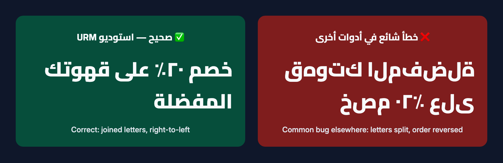
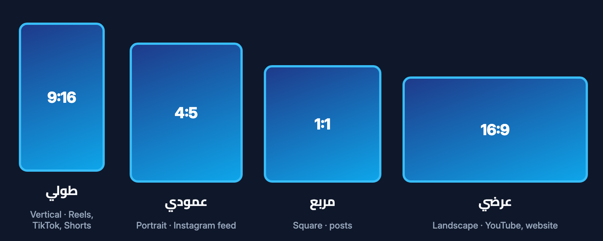
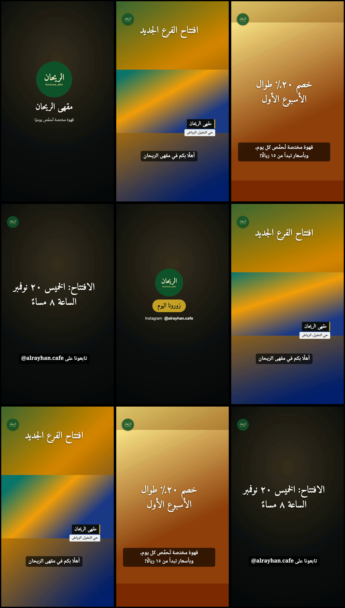
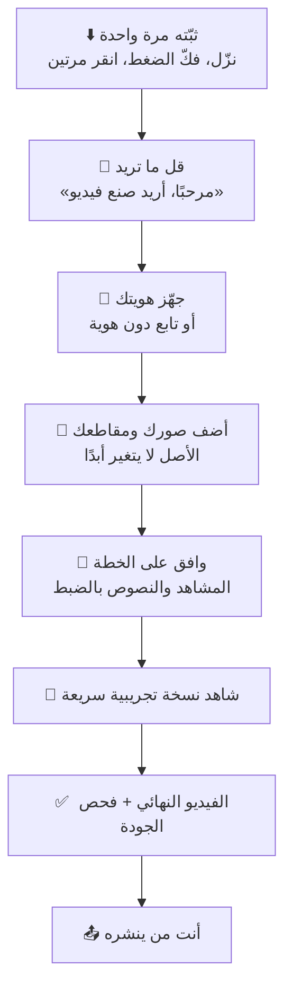
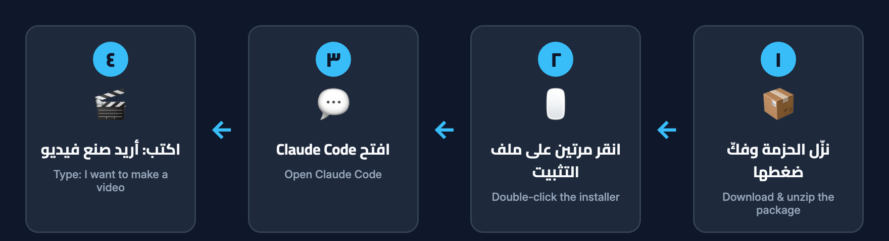

<div dir="rtl" lang="ar">

<div align="center">

# 🎬 استوديو URM للإبداع

### فيديوهات احترافية بهويتك أنت… بمجرد محادثة.

استوديو فيديو مجاني **يتحدث العربية أولًا**، يعمل داخل برنامج [Claude Code](https://docs.claude.com/en/docs/claude-code/overview).<br>
صِف الفيديو الذي تريده بالعربية أو الإنجليزية، واحصل على ملف فيديو نهائي جاهز للنشر.

[](https://github.com/ubaidadib/urm-creator-studio/releases/latest)
[](LICENSE)
[](#requirements)
[](#limitations)

**[⬇️ التحميل](https://github.com/ubaidadib/urm-creator-studio/releases/latest)** ·
**[🚀 التثبيت](#install)** ·
**[📖 الدليل الكامل](#documentation)** ·
**[🌐 English](README.md)**

</div>

<br>

<p align="center">
  
</p>

---

## ✨ ما هو استوديو URM للإبداع؟

استوديو URM للإبداع **إضافة (Skill)** لبرنامج Claude Code. تحوّل Claude إلى محرّر فيديو صبور يسألك أسئلة بسيطة،
ويخطط للمونتاج، ويضع **هويتك أنت**، ثم يُخرج الفيديو **على جهازك**.

| | |
|---|---|
| 👥 **لمن هو؟** | لأصحاب المشاريع الصغيرة، ورواد الأعمال، وصنّاع المحتوى، والمسوّقين، والأفراد، وخصوصًا **المتحدثين بالعربية الذين لم يستخدموا أدوات الذكاء الاصطناعي أو برامج المونتاج من قبل**. ومن يفضّل الإنجليزية يحصل على التجربة نفسها بالإنجليزية. |
| 🧩 **المشكلة** | برامج المونتاج تحتاج أسابيع لتعلّمها، وكثير من التطبيقات تُفسد النص العربي فتظهر الحروف منفصلة أو مقلوبة، والحفاظ على هوية موحّدة في كل فيديو أمر متعب. |
| 💡 **ما الفرق؟** | الدروس التعليمية تعلّمك كيف تستخدم برنامج مونتاج. أما هنا **فلا تستخدم أي برنامج بنفسك**: تجيب عن سؤال واحد في كل مرة، وتوافق على خطة، وتشاهد نسخة تجريبية سريعة، والاستوديو يتولى المونتاج. |
| 🌱 **بلا خبرة سابقة** | وضع المبتدئ لا يذكر مصطلحات تقنية ولا مسارات ملفات. كل خطوة تُشرح بكلمات بسيطة، ويُقترح عليك دائمًا الخيار الأنسب أولًا. |

> من صنع **URM ENROLL LTD** وتوزيعها مجانًا. فيديوهاتك تحمل **هويتك أنت**، لا هويتنا.

---

## 🧰 المزايا

| | الميزة | ماذا تحصل عليه |
|:-:|---|---|
| 🗣️ | **خطوات موجَّهة بالمحادثة** | سؤال بسيط واحد في كل مرة، ثم خطة توافق عليها، فنسخة تجريبية سريعة، ثم الفيديو النهائي. ثلاثة أوضاع: **المبتدئ** (الافتراضي) و**المبدع** و**المحترف**، وتنتقل بينها متى شئت بمجرد أن تطلب. |
| 🌐 | **العربية أولًا، مع دعم كامل للإنجليزية** | المحادثة والدليل والنصوص على الشاشة كلها بالعربية أو الإنجليزية، بحروف عربية متصلة، وترتيب صحيح للنص الذي يجمع العربية والإنجليزية. |
| 🎨 | **هويتك تُحفظ مرة واحدة** | الاسم، والشعار (أو اسمك مكتوبًا بخط جميل إن لم يكن لديك شعار)، والألوان (تصفها بكلماتك أو تُؤخذ من شعارك)، والخطوط، وحساباتك، والمقدمة والخاتمة، والجملة الختامية. غيّر أي شيء لاحقًا بمجرد أن تطلب. يمكنك حفظ أكثر من هوية، ولكل مشروع هوية واحدة. [دليل الهوية ←](docs/ar/04-دليل-الهوية.md) |
| 📐 | **أربعة أشكال للفيديو** | طولي ٩:١٦ (ريلز وتيك توك وشورتس)، وعمودي ٤:٥، ومربع ١:١، وعرضي ١٦:٩، مع إبقاء النصوص داخل المنطقة الآمنة لكل منصة. |
| 🔍 | **فحص ملفاتك** | قبل التخطيط، يفحص الاستوديو صورك ومقاطعك ويصنع منها لوحات مصغّرة، لتناسب الخطة ما في مقاطعك فعلًا. |
| 💬 | **الترجمة المكتوبة والخطوط** | ترجمة بصيغتي SRT وVTT، وتحويل اختياري للكلام إلى نص على جهازك (whisper.cpp) مع تمييز الكلمات غير الواضحة، وستة خطوط مرفقة بترخيص مفتوح: Cairo وTajawal وNoto Naskh Arabic وNoto Kufi Arabic وAmiri وInter. |
| 🎞️ | **الرسوم المتحركة** | حركات للنصوص (ظهور تدريجي، وصعود، وانزلاق جانبي، وتكبير، وكلمة بكلمة)، وانتقالات بين المشاهد (تلاشٍ، وانزلاق، وذوبان، ومسح، وتلاشٍ إلى الأسود أو الأبيض وغيرها)، وشريط تعريفي أسفل الشاشة، وعلامة الشعار، وأنماط جاهزة مثل الأنيق والحيوي والبسيط والجريء. |
| 🎧 | **الصوت** | موسيقاك مع خفض تلقائي لصوتها أثناء الكلام، ومؤثرات انتقال ناعمة اختيارية يولّدها المحرّك، وضبط مستوى الصوت ليناسب منصات التواصل. |
| ✅ | **فحص الجودة** | كل فيديو يُفحص بحثًا عن نص مقطوع، أو خارج المنطقة الآمنة، أو متداخل، أو وقت قراءة غير كافٍ، ومستوى الصوت وصيغة الملف، ثم يراجع المساعد صورًا حقيقية من الفيديو قبل أن يخبرك بالنتيجة. |
| 🔒 | **على جهازك، وبلا مساس بملفاتك** | المونتاج يتم على جهازك. تُنسخ ملفاتك الأصلية إلى مشروع **ولا تتغير أبدًا**، وكل فيديو يُحفظ في مجلد إصدار جديد مرقّم. |

### 🎬 ماذا يمكنك أن تصنع؟

ريلز وتيك توك وشورتس · إعلانات · فيديوهات لمنتج أو خدمة · تعريف بالشركة · فيديوهات تعليمية · لقطات من الفعاليات ·
فيديو حديث مباشر للكاميرا مع ترجمة مكتوبة · فيديوهات شخصية · فيديوهات أطول وحملات من عدة فيديوهات.

<details>
<summary><b>📐 شاهد أشكال الفيديو الأربعة</b></summary>
<br>
<p align="center"></p>
</details>

<details>
<summary><b>🖼️ شاهد صورًا من فيديو حقيقي صنعه الاستوديو</b> (هوية مقهى خيالية)</summary>
<br>
<p align="center"></p>
<p align="center"><sub>صور مأخوذة من فيديو أخرجه الاستوديو أثناء اختبارات القبول. الهوية خيالية.</sub></p>
</details>

---

## 🔄 كيف يعمل؟



في الخلفية، يقوم محرّك على جهازك (Python وFFmpeg) بالمونتاج، وتُرسم النصوص بواسطة متصفح Chrome أو Edge، وهذا ما
يجعل الحروف العربية متصلة بشكل صحيح. الاستوديو **لا ينشر ولا يرفع** أي شيء.

---

<a id="install"></a>

## 🚀 البدء

<a id="requirements"></a>

### ✅ ما تحتاجه قبل التثبيت

| المطلوب | ملاحظات |
|---|---|
| برنامج **Claude Code** مع **اشتراك مدفوع مناسب في Claude** (أو حساب Anthropic API) | التفاصيل في [claude.com/pricing](https://claude.com/pricing). يحتاج Claude Code إلى اتصال بالإنترنت. |
| جهاز كمبيوتر | **ماك بنظام 12 أو أحدث (تمت تجربته).** ويندوز 10 و11 ولينكس لهما مثبّت، لكن **لم يُجرَّبا بعد على أجهزة حقيقية**. |
| بايثون 3.8 أو أحدث، وبرنامج FFmpeg | المثبّت يفحصهما، ويعرض تثبيت FFmpeg بعد أن يستأذنك. |
| متصفح Google Chrome أو Microsoft Edge | يُستخدم دون إنترنت لرسم النصوص. |
| *اختياري:* whisper.cpp | يحوّل الكلام إلى ترجمة مكتوبة على جهازك. |

📄 التفاصيل: [المتطلبات](docs/ar/01-المتطلبات.md)

### 1️⃣ التحميل

نزّل الملف **<code dir="ltr">URM-Creator-Studio-v1.0.0.zip</code>** من
**[صفحة آخر إصدار](https://github.com/ubaidadib/urm-creator-studio/releases/latest)**، ثم فكّ ضغطه.
تعرض صفحة الإصدار أيضًا رمز التحقق SHA-256 الخاص بالملف.

<p align="center"></p>

### 2️⃣ التثبيت

انقر مرتين على ملف التثبيت داخل المجلد الذي فككت ضغطه:

| الجهاز | ملف التثبيت |
|---|---|
| 🍎 **ماك** (تمت تجربته) | <code dir="ltr">Install-macOS.command</code><br>بالإنجليزية: <code dir="ltr">Install-macOS-English.command</code> |
| 🪟 **ويندوز** (لم يُجرَّب بعد) | <code dir="ltr">Install-Windows.bat</code><br>بالإنجليزية: <code dir="ltr">Install-Windows-English.bat</code> |
| 🐧 **لينكس** (لم يُجرَّب بعد) | <code dir="ltr">bash install.sh</code><br>بالإنجليزية: <code dir="ltr">bash install.sh --en</code> |

ينسخ المثبّت الاستوديو إلى <code dir="ltr">~/.claude/skills/urm-creator-studio</code>، ويُنشئ مجلد عملك <code dir="ltr">URM-Creator-Studio</code> داخل
مجلدك الشخصي، ويفحص جهازك.

> 💡 **نصيحة:** إذا منع نظام ماك تشغيل المثبّت: انقر عليه **بالزر الأيمن**، ثم **«فتح»**، ثم **«فتح»** مرة أخرى.

### 3️⃣ أول فيديو لك

افتح Claude Code واكتب:

```text
مرحبًا، أريد صنع فيديو
```

(أو <code dir="ltr">/urm-creator-studio</code>). سيسألك المساعد عن نوع الفيديو، ويساعدك في إعداد هويتك، ويطلب ملفاتك: ضعها في مجلد
<code dir="ltr">inbox</code> داخل مجلد عملك، أو اسحبها إلى المحادثة. بعد ذلك يعرض عليك خطة، فنسخة تجريبية سريعة، ثم الفيديو النهائي،
ويفتح لك المجلد على الشاشة.

📄 الأدلة خطوة بخطوة: [التثبيت (مع صور)](docs/ar/02-التثبيت.md) ·
[البداية السريعة](docs/ar/03-البداية-السريعة.md)

### 🛟 مشكلات شائعة في المرة الأولى

| المشكلة | الحل |
|---|---|
| **نظام ماك يمنع المثبّت** | انقر على <code dir="ltr">Install-macOS.command</code> بالزر الأيمن، ثم «فتح»، ثم «فتح». |
| **رسالة «لم أجد ملفات الاستوديو»** | فكّ ضغط الحزمة كاملة، وشغّل المثبّت من داخل المجلد نفسه. |
| **Claude Code لا يعرف الاستوديو** | أغلق Claude Code تمامًا، ثم افتحه من جديد. |
| **برنامج FFmpeg غير موجود** | ماك: <code dir="ltr">brew install ffmpeg</code><br>ويندوز: <code dir="ltr">winget install --id Gyan.FFmpeg -e</code><br>لينكس: <code dir="ltr">sudo apt install ffmpeg</code><br>ويمكن للمساعد أن يرشدك. |
| **لم يُعثر على Chrome أو Edge** | ثبّت متصفح Google Chrome. وتعمل أيضًا متصفحات Edge وChromium وBrave. |

📄 المزيد: [حل المشكلات](docs/ar/07-حل-المشكلات.md)

---

## 🌐 اللغات

| | العربية | الإنجليزية |
|---|---|---|
| **المحادثة** | ✅ الافتراضية | ✅ اطلبها متى شئت، أو اكتب بالإنجليزية |
| **ملفات التثبيت** | ✅ الافتراضية | ✅ نسخ إنجليزية مرفقة |
| **النصوص والترجمة على الشاشة** | ✅ حروف متصلة، من اليمين إلى اليسار، بأرقام عربية أو غربية | ✅ |
| **فيديو بلغتين** | ✅ العربية والإنجليزية في الفيديو نفسه، بترتيب صحيح | ✅ |
| **الدليل** | ✅ [الدليل الكامل](docs/ar/00-الفهرس.md) | ✅ [Full guide](docs/en/00-index.md) |

كل نص عربي يُشكَّل بمحرّك متصفح، ثم يُراجَع في صور مأخوذة من الفيديو النهائي نفسه، ولا يُفترض أنه صحيح دون فحص.
📄 [دليل الخط العربي](docs/ar/06-الخط-العربي.md)

---

## 🔐 الخصوصية والبيانات

- 💻 محرّك الفيديو يعمل **على جهازك** ولا يرفع ملفاتك، وتحويل الكلام إلى نص يتم على جهازك أيضًا.
- 🤖 أما محادثتك مع Claude، والصور التي يفتحها المساعد لمراجعة الفيديو (مثل الشعار وصور من الفيديو)، فتعالجها
  شركة **Anthropic** وفق شروطها وسياسة الخصوصية الخاصة بها.
- 🚫 لا يُنشر أي شيء نيابةً عنك. ولا تضع بيانات شخصية لأشخاص آخرين في الفيديو دون إذنهم.

---

<a id="limitations"></a>

## ⚖️ الحدود والشفافية

الإصدار 1.0.0 هو أول إصدار عام، ونفضّل أن نخبرك بوضوح أين يقف اليوم:

| المجال | الوضع الحالي |
|---|---|
| 🖥️ **أنظمة التشغيل** | تمت تجربته على ماك. مثبّتا **ويندوز ولينكس** لم يُجرَّبا بعد على أجهزة حقيقية. |
| 🎙️ **تحويل الكلام العربي إلى نص** | قد يخطئ **حتى عندما يبدو واثقًا**. راجع الترجمة دائمًا قبل إضافتها؛ الكلمات غير الواضحة تُميَّز للمراجعة ولا تُخمَّن أبدًا. |
| 📱 **مقاطع iPhone بتقنية HDR** | قد تتغير ألوانها قليلًا (نسخ FFmpeg الشائعة لا تدعم تحويل HDR بالكامل). |
| 🔊 **التعليق الصوتي المدمج** | يعمل على ماك فقط، وبموافقتك الصريحة. ويُذكر بوضوح أنه صوت مُولَّد. |
| 📦 **تثبيت تحويل الكلام إلى نص** | تثبيت إضافي اختياري: whisper.cpp وملف نموذج حجمه نحو 1.6 غيغابايت. |
| 🧪 **تجربة المبتدئين** | جُرّبت بجلسات محاكاة، ولم تُجرَّب بعد مع مستخدمين حقيقيين. |

**ضمانات مدمجة عن قصد:**

- ✋ يطلب الاستوديو موافقتك على الخطة، وبعد النسخة التجريبية، وقبل تثبيت أي برنامج.
- 🗂️ لا تُستبدل ملفاتك الأصلية أبدًا، وكل فيديو يُحفظ كإصدار جديد.
- 🎵 استخدم فقط الصور والمقاطع والموسيقى والخطوط التي تملكها أو لديك ترخيص لها. ولا يُنزّل الاستوديو موسيقى أو
  مقاطع من الإنترنت لفيديوهاتك.
- 🙅 لا نشر تلقائي، ولا أشخاص مصنوعون بالذكاء الاصطناعي، ولا تقليد للأصوات.

📄 تقرير الاختبارات الكامل (بالإنجليزية): [tests/TEST_REPORT.md](https://github.com/ubaidadib/urm-creator-studio/blob/main/tests/TEST_REPORT.md) ·
شروط الاستخدام: [USAGE-TERMS.ar.md](USAGE-TERMS.ar.md)

---

<a id="documentation"></a>

## 📖 الدليل الكامل

| | العربية | English |
|:-:|---|---|
| 🗂️ | [الفهرس](docs/ar/00-الفهرس.md) | [Index](docs/en/00-index.md) |
| 📋 | [المتطلبات](docs/ar/01-المتطلبات.md) | [Requirements](docs/en/01-requirements.md) |
| ⚙️ | [التثبيت](docs/ar/02-التثبيت.md) | [Installation](docs/en/02-installation.md) |
| 🚀 | [البداية السريعة](docs/ar/03-البداية-السريعة.md) | [Getting started](docs/en/03-getting-started.md) |
| 🎨 | [دليل الهوية](docs/ar/04-دليل-الهوية.md) | [Brand guide](docs/en/04-brand-guide.md) |
| 🎬 | [صناعة الفيديو](docs/ar/05-دليل-صناعة-الفيديو.md) | [Video guide](docs/en/05-video-guide.md) |
| ✍️ | [الخط العربي](docs/ar/06-الخط-العربي.md) | [Arabic typography](docs/en/06-arabic-typography.md) |
| 🛟 | [حل المشكلات](docs/ar/07-حل-المشكلات.md) | [Troubleshooting](docs/en/07-troubleshooting.md) |
| 💡 | [أمثلة](docs/ar/08-أمثلة.md) | [Examples](docs/en/08-examples.md) |
| ❓ | [الأسئلة الشائعة](docs/ar/09-الأسئلة-الشائعة.md) | [FAQ](docs/en/09-faq.md) |

<details>
<summary><b>🗃️ محتويات المستودع</b></summary>

<div dir="ltr">

```text
skill/urm-creator-studio/   the Claude Code skill: SKILL.md, reference/, scripts/ (engine), fonts/
docs/en  docs/ar            user guides
examples/                   fictional brand profiles and example briefs
tests/                      synthetic test-media generator, acceptance suite, test report
tools/                      release builder, documentation image generator
install.sh  install.ps1     installers, plus double-click launchers
```

</div>

- <code dir="ltr">skill/urm-creator-studio/</code>: الإضافة نفسها (التعليمات، والمراجع، والمحرّك، والخطوط).
- <code dir="ltr">docs/ar</code> و<code dir="ltr">docs/en</code>: أدلة المستخدم بالعربية والإنجليزية.
- <code dir="ltr">examples/</code>: هويات وطلبات فيديو خيالية للتجربة.
- <code dir="ltr">tests/</code>: مولّد ملفات اختبار، واختبارات القبول، وتقرير الاختبارات.
- <code dir="ltr">tools/</code>: أداة بناء حزمة الإصدار، ومولّد صور الدليل.
- <code dir="ltr">install.sh</code> و<code dir="ltr">install.ps1</code>: ملفات التثبيت، مع ملفات التشغيل بالنقر المزدوج.

</details>

---

## 🤝 المجتمع

| | |
|---|---|
| 🐞 **الإبلاغ عن مشكلة** | افتح [بلاغًا جديدًا (Issue)](https://github.com/ubaidadib/urm-creator-studio/issues) بالعربية أو الإنجليزية، واذكر نظام جهازك، وما طلبته، والرسالة التي ظهرت لك. |
| 🛡️ **المشكلات الأمنية** | لا تفتح بلاغًا عامًا من فضلك. راجع [SECURITY.md](SECURITY.md) للإبلاغ بشكل خاص. |
| 🛠️ **المساهمة** | راجع [CONTRIBUTING.md](https://github.com/ubaidadib/urm-creator-studio/blob/main/CONTRIBUTING.md). |
| 📝 **التغييرات** | [CHANGELOG.md](CHANGELOG.md) · [ملاحظات الإصدار](RELEASE_NOTES.md) · [كل الإصدارات](https://github.com/ubaidadib/urm-creator-studio/releases) |

## 📜 الترخيص

البرنامج مرخّص بترخيص [MIT](LICENSE)، وحقوق النشر © 2026 لشركة URM ENROLL LTD. والخطوط المرفقة مرخّصة بترخيص
SIL Open Font License 1.1 الذي يسمح باستخدامها تجاريًا (راجع [THIRD_PARTY_NOTICES.md](THIRD_PARTY_NOTICES.md)).
شروط الاستخدام: [USAGE-TERMS.ar.md](USAGE-TERMS.ar.md) · [USAGE-TERMS.md](USAGE-TERMS.md).

Claude وClaude Code منتجان لشركة Anthropic، وهذا المشروع غير تابع لها ولا معتمد منها.

<div align="center">
<br>

**[⬇️ حمّل استوديو URM للإبداع](https://github.com/ubaidadib/urm-creator-studio/releases/latest)** · **[🌐 Read in English](README.md)**

<sub>صُنع بعناية من URM ENROLL LTD، ومجاني للجميع.</sub>

</div>

</div>
