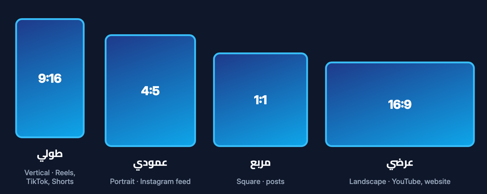
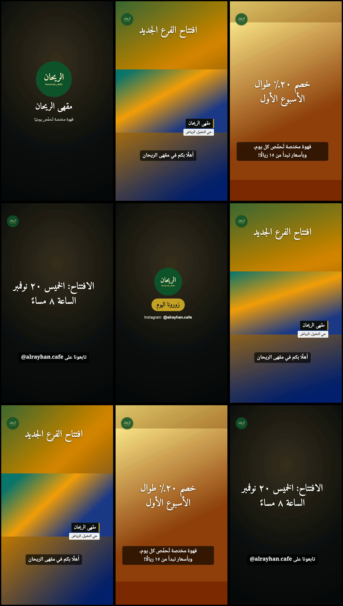
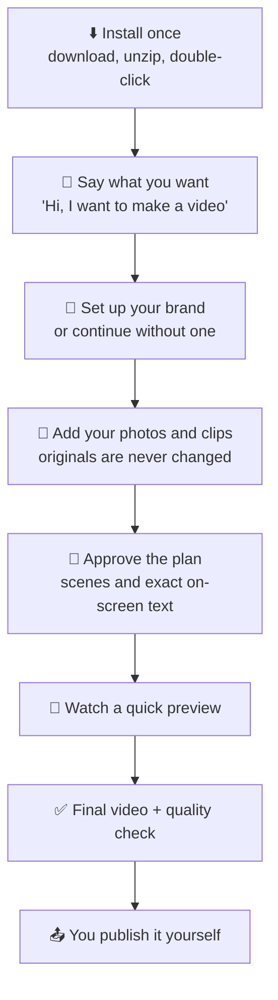

<div align="center">

# 🎬 URM Creator Studio

### Professional videos in your own brand, just by chatting.

A free, **Arabic-first** video studio for [Claude Code](https://docs.claude.com/en/docs/claude-code/overview).<br>
Describe the video you want in Arabic or English, and get a finished, ready-to-post MP4.

[](https://github.com/ubaidadib/urm-creator-studio/releases/latest)
[](LICENSE)
[](#requirements)
[](#limitations)

**[⬇️ Download](https://github.com/ubaidadib/urm-creator-studio/releases/latest)** ·
**[🚀 Install](#install)** ·
**[📖 Documentation](#documentation)** ·
**[🌐 العربية](README.ar.md)**

</div>

<br>

<p align="center">
  
</p>

---

## ✨ What is URM Creator Studio?

URM Creator Studio is a **skill** (an add-on) for Claude Code. It turns Claude into a patient video editor that
asks you simple questions, plans the edit, applies **your** brand, and exports the video on **your computer**.

| | |
|---|---|
| 👥 **Who it's for** | Small businesses, entrepreneurs, creators, marketers and individuals, especially **Arabic speakers who have never used AI tools or video editors**. English speakers get the same experience in English. |
| 🧩 **The problem** | Editing apps take weeks to learn, many apps break Arabic text (letters come out disconnected or reversed), and keeping a consistent brand across videos is tedious. |
| 💡 **The difference** | A tutorial teaches you how to operate an editor. Here **you don't operate anything**: you answer one question at a time, approve a plan, watch a quick test version, and the studio does the editing. |
| 🌱 **No experience needed** | Beginner mode never mentions codecs, frame rates or file paths. Every step is explained in plain words, and a recommended option is always offered first. |

> Made and distributed free by **URM ENROLL LTD**. Your videos carry **your** brand, never ours.

---

## 🧰 Features

| | Feature | What you get |
|:-:|---|---|
| 🗣️ | **Guided, chat-based workflow** | One simple question at a time, a plan you approve, a quick preview, then the final video. Three modes: **Beginner** (default), **Creator** and **Pro**; switch any time by asking. |
| 🌐 | **Arabic-first, fully bilingual** | The whole conversation, documentation and on-screen text work in Arabic or English, with correctly joined Arabic letters and properly ordered mixed Arabic/English text. |
| 🎨 | **Your brand, saved once** | Name, logo (or a typographic wordmark if you have none), colours (described in words or taken from your logo), fonts, social handles, intro, outro and call to action. Change anything later just by asking. Several brands; one per project. [Brand guide →](docs/en/04-brand-guide.md) |
| 📐 | **Four video shapes** | Vertical 9:16 (Reels, TikTok, Shorts), portrait 4:5, square 1:1 and landscape 16:9, with text kept inside each platform's safe area. |
| 🔍 | **Media inspection** | Before planning, the studio inspects your photos and clips and builds contact sheets so the plan fits what is actually in your footage. |
| 💬 | **Captions and typography** | Subtitles in SRT/VTT, optional local speech-to-text (whisper.cpp) with unclear words flagged, and six bundled open-licence fonts: Cairo, Tajawal, Noto Naskh Arabic, Noto Kufi Arabic, Amiri and Inter. |
| 🎞️ | **Motion graphics** | Text animations (fade, slide up, side slide, zoom, word by word), transitions (fade, slide, dissolve, wipes, fade to black/white and more), lower thirds, logo watermark, and style presets such as elegant, energetic, minimal and bold. |
| 🎧 | **Audio** | Your music with automatic ducking under speech, optional soft transition sounds generated by the engine, and loudness levelled for social platforms. |
| ✅ | **Quality checks** | Every export is checked for cut-off text, safe areas, overlapping text, reading time, loudness and file format, and the assistant reviews real frames from the video before reporting. |
| 🔒 | **Local and non-destructive** | Editing runs on your computer. Your original files are **copied** into a project and never changed, and every export goes to a new numbered version folder. |

### 🎬 What you can make

Reels, TikTok and Shorts · ads · product and service videos · company introductions · educational videos ·
event highlights · talking-head clips with subtitles · personal videos · longer videos and campaign series.

<details>
<summary><b>📐 See the four video shapes</b></summary>
<br>
<p align="center"></p>
</details>

<details>
<summary><b>🖼️ See frames from a real test render</b> (fictional café brand)</summary>
<br>
<p align="center"></p>
<p align="center"><sub>Frames taken from a video exported by the studio during acceptance testing. The brand is fictional.</sub></p>
</details>

---

## 🔄 How it works



Behind the scenes, a local engine (Python + FFmpeg) does the editing. On-screen text is drawn by Chrome or Edge
in the background, which is what makes Arabic letters join correctly. The studio **never posts or uploads**
anything.

---

<a id="install"></a>

## 🚀 Getting started

<a id="requirements"></a>

### ✅ Before you install

| You need | Notes |
|---|---|
| **Claude Code** with an eligible **paid Claude plan** (or an Anthropic API account) | See [claude.com/pricing](https://claude.com/pricing). Claude Code needs an internet connection. |
| A computer | **macOS 12+ (tested).** Windows 10/11 and Linux have installers but are **not yet verified on real machines**. |
| Python 3.8+ and FFmpeg | The installer checks them and offers to install FFmpeg (it asks first). |
| Google Chrome or Microsoft Edge | Used offline to draw text. |
| *Optional:* whisper.cpp | Turns speech into subtitles on your computer. |

📄 Details: [Requirements](docs/en/01-requirements.md)

### 1️⃣ Download

Download **`URM-Creator-Studio-v1.0.0.zip`** from the
**[latest release](https://github.com/ubaidadib/urm-creator-studio/releases/latest)** and unzip it.
The release page also lists the file's SHA-256 checksum.

### 2️⃣ Install

Double-click the installer inside the unzipped folder:

| Computer | Installer |
|---|---|
| 🍎 **Mac** (tested) | `Install-macOS-English.command`<br>Arabic messages: `Install-macOS.command` |
| 🪟 **Windows** (not yet verified) | `Install-Windows-English.bat`<br>Arabic messages: `Install-Windows.bat` |
| 🐧 **Linux** (not yet verified) | `bash install.sh --en`<br>Arabic messages: `bash install.sh` |

The installer copies the skill to `~/.claude/skills/urm-creator-studio`, creates your workspace folder
`~/URM-Creator-Studio`, and checks your computer.

> 💡 **Tip:** If macOS blocks the installer: **right-click** it → **Open** → **Open**.

### 3️⃣ Make your first video

Open Claude Code and type:

```text
Hi, I want to make a video
```

(or `/urm-creator-studio`). The assistant asks what you want to make, helps you set up your brand, and asks for
your files: put them in `~/URM-Creator-Studio/inbox` or drag them into the chat. It then shows you a plan, makes
a quick test version, renders the final video and opens the folder for you.

📄 Step-by-step guides: [Installation (with pictures)](docs/en/02-installation.md) ·
[Getting started](docs/en/03-getting-started.md)

### 🛟 Common first-time issues

| Problem | Fix |
|---|---|
| **Mac blocks the installer** | Right-click `Install-macOS.command` → **Open** → **Open**. |
| **"Studio files not found"** | Unzip the whole package and run the installer from inside the unzipped folder. |
| **Claude Code doesn't know the studio** | Quit Claude Code completely and open it again. |
| **FFmpeg missing** | Mac: `brew install ffmpeg`<br>Windows: `winget install --id Gyan.FFmpeg -e`<br>Linux: `sudo apt install ffmpeg`<br>The assistant can guide you. |
| **Chrome or Edge not found** | Install Google Chrome. Edge, Chromium and Brave also work. |

📄 More: [Troubleshooting](docs/en/07-troubleshooting.md)

---

## 🌐 Languages

| | Arabic | English |
|---|---|---|
| **Conversation** | ✅ Default | ✅ Ask any time, or write in English |
| **Installers** | ✅ Default | ✅ English versions included |
| **On-screen text and captions** | ✅ Joined letters, right-to-left, Arabic or Western digits | ✅ |
| **Bilingual videos** | ✅ Arabic and English in the same video, correctly ordered | ✅ |
| **Documentation** | ✅ [Full guide](docs/ar/00-الفهرس.md) | ✅ [Full guide](docs/en/00-index.md) |

Every Arabic text is shaped by a browser engine and then checked in frames taken from the exported video, never
assumed. 📄 [Arabic typography guide](docs/en/06-arabic-typography.md)

---

## 🔐 Privacy and data

- 💻 The video engine runs **on your computer** and does not upload your files. Speech-to-text also runs locally.
- 🤖 Your conversation with Claude, and any images the assistant opens to check your video (logo, preview
  frames), are processed by **Anthropic** under its terms and privacy policy.
- 🚫 Nothing is ever published for you. Don't put other people's personal data in videos without permission.

---

<a id="limitations"></a>

## ⚖️ Limitations and transparency

Version 1.0.0 is a first public release. We prefer to tell you exactly where it stands:

| Area | Current status |
|---|---|
| 🖥️ **Platforms** | Tested on macOS. The **Windows and Linux** installers have not been tested on real machines yet. |
| 🎙️ **Arabic speech-to-text** | Can be wrong **even when it looks confident**. Always review subtitles before they are added; unclear words are marked for review, never guessed. |
| 📱 **iPhone HDR clips** | Colours may shift slightly (common FFmpeg builds have no full HDR tone-mapping). |
| 🔊 **Built-in narration voice** | Works on Mac only, and only with your explicit consent. Synthetic narration is labelled as such. |
| 📦 **Speech-to-text install** | Optional extra install: whisper.cpp plus a model file of about 1.6 GB. |
| 🧪 **Beginner testing** | Onboarding was tested with simulated beginner sessions, not yet with real users. |

**Built-in safeguards, by design:**

- ✋ The studio asks for your approval before the plan, after the preview, and before installing anything.
- 🗂️ Original files are never overwritten; every export is a new version.
- 🎵 Use only media, music and fonts you own or have a licence for. The studio never downloads music or footage
  from the internet for your video.
- 🙅 No automatic posting, no AI-generated people, and no voice cloning.

📄 Full test report: [tests/TEST_REPORT.md](https://github.com/ubaidadib/urm-creator-studio/blob/main/tests/TEST_REPORT.md) ·
Usage terms: [USAGE-TERMS.md](USAGE-TERMS.md)

---

<a id="documentation"></a>

## 📖 Documentation

| | English | العربية |
|:-:|---|---|
| 🗂️ | [Index](docs/en/00-index.md) | [الفهرس](docs/ar/00-الفهرس.md) |
| 📋 | [Requirements](docs/en/01-requirements.md) | [المتطلبات](docs/ar/01-المتطلبات.md) |
| ⚙️ | [Installation](docs/en/02-installation.md) | [التثبيت](docs/ar/02-التثبيت.md) |
| 🚀 | [Getting started](docs/en/03-getting-started.md) | [البداية السريعة](docs/ar/03-البداية-السريعة.md) |
| 🎨 | [Brand guide](docs/en/04-brand-guide.md) | [دليل الهوية](docs/ar/04-دليل-الهوية.md) |
| 🎬 | [Video guide](docs/en/05-video-guide.md) | [صناعة الفيديو](docs/ar/05-دليل-صناعة-الفيديو.md) |
| ✍️ | [Arabic typography](docs/en/06-arabic-typography.md) | [الخط العربي](docs/ar/06-الخط-العربي.md) |
| 🛟 | [Troubleshooting](docs/en/07-troubleshooting.md) | [حل المشكلات](docs/ar/07-حل-المشكلات.md) |
| 💡 | [Examples](docs/en/08-examples.md) | [أمثلة](docs/ar/08-أمثلة.md) |
| ❓ | [FAQ](docs/en/09-faq.md) | [الأسئلة الشائعة](docs/ar/09-الأسئلة-الشائعة.md) |

<details>
<summary><b>🗃️ Repository layout</b></summary>

```text
skill/urm-creator-studio/   the Claude Code skill: SKILL.md, reference/, scripts/ (engine), fonts/
docs/en  docs/ar            user guides
examples/                   fictional brand profiles and example briefs
tests/                      synthetic test-media generator, acceptance suite, test report
tools/                      release builder, documentation image generator
install.sh  install.ps1     installers, plus double-click launchers
```

</details>

---

## 🤝 Community

| | |
|---|---|
| 🐞 **Report a problem** | Open an [issue](https://github.com/ubaidadib/urm-creator-studio/issues) in Arabic or English. Include your operating system, what you asked for, and the message you saw. |
| 🛡️ **Security** | Please don't open a public issue. See [SECURITY.md](SECURITY.md) for private reporting. |
| 🛠️ **Contribute** | See [CONTRIBUTING.md](https://github.com/ubaidadib/urm-creator-studio/blob/main/CONTRIBUTING.md). |
| 📝 **Changes** | [CHANGELOG.md](CHANGELOG.md) · [Release notes](RELEASE_NOTES.md) · [All releases](https://github.com/ubaidadib/urm-creator-studio/releases) |

## 📜 License

Code: [MIT](LICENSE) © 2026 URM ENROLL LTD. Bundled fonts: SIL Open Font License 1.1
(see [THIRD_PARTY_NOTICES.md](THIRD_PARTY_NOTICES.md)). Usage terms: [USAGE-TERMS.md](USAGE-TERMS.md) ·
[USAGE-TERMS.ar.md](USAGE-TERMS.ar.md).

Claude and Claude Code are products of Anthropic. This project is not affiliated with or endorsed by Anthropic.

<div align="center">
<br>

**[⬇️ Download URM Creator Studio](https://github.com/ubaidadib/urm-creator-studio/releases/latest)** · **[🌐 اقرأ بالعربية](README.ar.md)**

<sub>Made with care by URM ENROLL LTD, free for everyone.</sub>

</div>
