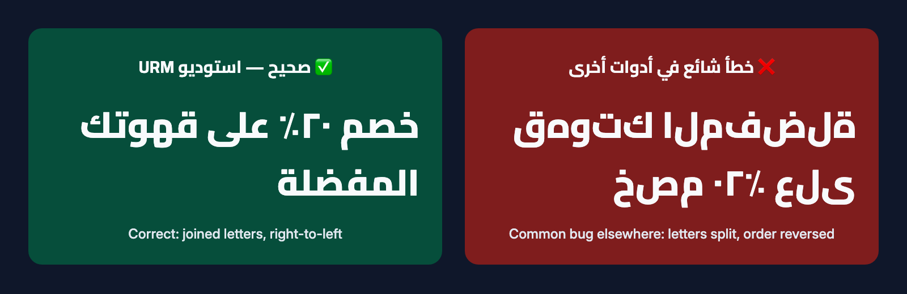

# URM Creator Studio

**🌐 Language / اللغة: [English](#english) · [العربية](README.ar.md)**

[](https://github.com/ubaidadib/urm-creator-studio/releases/latest)
[](LICENSE)


<a id="english"></a>

**A beginner-friendly, Arabic-first video studio that you use by chatting.** URM Creator Studio is a free
skill for [Claude Code](https://docs.claude.com/en/docs/claude-code/overview). Tell it in Arabic or English
what video you want; it plans the edit, applies **your** brand, writes correctly shaped Arabic or English
text and subtitles, and exports a ready-to-post video. No editing experience is needed.

Made and distributed free by **URM ENROLL**. Your videos carry your brand, never ours.



## Who it's for
Small businesses, entrepreneurs, creators, marketers and individuals, especially **Arabic speakers who have
never used AI tools or video editors**. English speakers get the same experience in English.

## Problems it solves
- Video editors are hard to learn. Here you answer simple questions, one at a time.
- Many apps break Arabic: letters come out disconnected or reversed. Here every Arabic text is shaped by a
  browser engine and checked in the exported frames.
- Keeping a consistent brand is tedious. Save your logo, colours, fonts and handles once; every video uses them.

## What you can make
Reels / TikTok / Shorts · ads · product and service videos · company introductions · educational videos ·
event highlights · talking-head clips with subtitles · personal videos · longer videos and campaign series.
Shapes: vertical 9:16, portrait 4:5, square 1:1 and landscape 16:9.

## How it works
1. You chat with Claude Code. The studio skill guides it (Beginner, Creator or Pro mode).
2. Your photos, clips, logo and music are **copied** into a project. Originals are never changed.
3. A local engine (Python + FFmpeg) edits the video. On-screen text is drawn by Chrome or Edge in the
   background, which joins Arabic letters correctly and orders mixed Arabic/English text properly.
4. Automatic checks plus frame-by-frame review by the assistant; then you get a finished MP4.
5. You publish it yourself. The studio never posts or uploads anything.

## Before you install
| You need | Notes |
|---|---|
| **Claude Code** with an eligible **paid Claude plan** (or an Anthropic API account) | See [claude.com/pricing](https://claude.com/pricing). Claude Code needs an internet connection. |
| A computer | **macOS 12+ (tested).** Windows 10/11 and Linux have installers but are **not yet verified on real machines**. |
| Python 3.8+, FFmpeg | The installer checks them and offers to install FFmpeg (asks first). |
| Google Chrome or Microsoft Edge | Used offline to draw text. |
| Optional: whisper.cpp | Turns speech into subtitles, on your computer. |

Details: [docs/en/01-requirements.md](docs/en/01-requirements.md)

## Install
1. Download **`URM-Creator-Studio-v1.0.0.zip`** from the
   [latest release](https://github.com/ubaidadib/urm-creator-studio/releases/latest) and unzip it.
2. Double-click the installer:
   - Mac: **`Install-macOS-English.command`** (or `Install-macOS.command` for Arabic messages).
     If macOS blocks it: right-click → Open → Open.
   - Windows (not yet verified): **`Install-Windows-English.bat`** (or `Install-Windows.bat` for Arabic).
   - Linux (not yet verified): `bash install.sh --en`
3. The installer copies the skill to `~/.claude/skills/urm-creator-studio`, creates your workspace folder
   `~/URM-Creator-Studio`, and checks your computer.

Step-by-step guide with pictures: [docs/en/02-installation.md](docs/en/02-installation.md)

## Your first video
Open Claude Code and type: **Hi, I want to make a video** (or `/urm-creator-studio`).
The assistant asks what you want to make, sets up your brand, asks for your files (put them in
`~/URM-Creator-Studio/inbox` or drag them into the chat), shows you a plan, makes a quick test version, then
the final video, and opens the folder for you. → [docs/en/03-getting-started.md](docs/en/03-getting-started.md)

## Your own branding
Name (Arabic, English or both), logo (or a typographic wordmark if you have none), colours (described in words,
or taken from your logo), fonts, social handles, intro/outro and call to action. Change anything later just by
asking. Several brands are supported, and each project uses exactly one. → [docs/en/04-brand-guide.md](docs/en/04-brand-guide.md)

## Privacy and data
- The video engine runs **on your computer** and does not upload your files. Speech-to-text runs locally.
- Your conversation with Claude, and any images the assistant opens to check your video (logo, preview frames),
  are processed by **Anthropic** under its terms and privacy policy.
- Nothing is ever published for you. Don't put other people's personal data in videos without permission.

## Known limitations (v1.0.0)
- **Windows and Linux** installers have not been tested on real machines yet.
- **Arabic speech-to-text can be wrong, even when confident.** Always review subtitles before they are added.
- **iPhone HDR clips**: colours may shift slightly (no full HDR tone-mapping in common FFmpeg builds).
- **Built-in narration voice** works on Mac only, and only with your explicit consent.
- Speech-to-text needs an optional extra install (whisper.cpp plus a model file of about 1.6 GB).
- No automatic posting, no AI-generated people, no voice cloning (by design).
- Onboarding was tested with simulated beginner sessions, not yet with real users.

Full test report: [tests/TEST_REPORT.md](https://github.com/ubaidadib/urm-creator-studio/blob/main/tests/TEST_REPORT.md)

## Documentation
| English | العربية |
|---|---|
| [Index](docs/en/00-index.md) | [الفهرس](docs/ar/00-الفهرس.md) |
| [Requirements](docs/en/01-requirements.md) · [Installation](docs/en/02-installation.md) | [المتطلبات](docs/ar/01-المتطلبات.md) · [التثبيت](docs/ar/02-التثبيت.md) |
| [Getting started](docs/en/03-getting-started.md) · [Brand guide](docs/en/04-brand-guide.md) | [البداية السريعة](docs/ar/03-البداية-السريعة.md) · [دليل الهوية](docs/ar/04-دليل-الهوية.md) |
| [Video guide](docs/en/05-video-guide.md) · [Arabic typography](docs/en/06-arabic-typography.md) | [صناعة الفيديو](docs/ar/05-دليل-صناعة-الفيديو.md) · [الخط العربي](docs/ar/06-الخط-العربي.md) |
| [Troubleshooting](docs/en/07-troubleshooting.md) · [Examples](docs/en/08-examples.md) · [FAQ](docs/en/09-faq.md) | [حل المشكلات](docs/ar/07-حل-المشكلات.md) · [أمثلة](docs/ar/08-أمثلة.md) · [الأسئلة الشائعة](docs/ar/09-الأسئلة-الشائعة.md) |

## Repository layout
```
skill/urm-creator-studio/   the Claude Code skill: SKILL.md, reference/, scripts/ (engine), fonts/
docs/en  docs/ar            user guides
examples/                   fictional brand profiles and example briefs
tests/                      synthetic test-media generator, acceptance suite, test report
tools/                      release builder, documentation image generator
install.sh  install.ps1     installers, plus double-click launchers
```

## Reporting issues
Please open an [issue](https://github.com/ubaidadib/urm-creator-studio/issues) (Arabic or English is fine).
Include your operating system, what you asked for, and the message you saw. Security problems: see
[SECURITY.md](SECURITY.md). Contributions: see [CONTRIBUTING.md](https://github.com/ubaidadib/urm-creator-studio/blob/main/CONTRIBUTING.md).

## License
Code: [MIT](LICENSE). Bundled fonts: SIL Open Font License 1.1 (see [THIRD_PARTY_NOTICES.md](THIRD_PARTY_NOTICES.md)).
Usage terms: [USAGE-TERMS.md](USAGE-TERMS.md) · [USAGE-TERMS.ar.md](USAGE-TERMS.ar.md).
Claude and Claude Code are products of Anthropic; this project is not affiliated with or endorsed by Anthropic.
