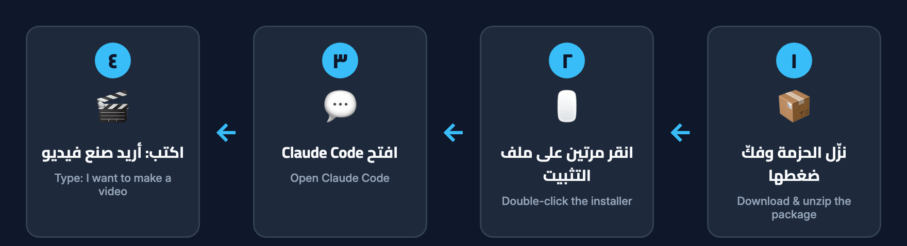

<div dir="rtl" lang="ar">

[الفهرس](00-الفهرس.md) · السابق: [المتطلبات](01-المتطلبات.md) · التالي: [البداية السريعة](03-البداية-السريعة.md)

# التثبيت 🛠

التثبيت يتم **مرة واحدة فقط**، ويستغرق عادةً بين 10 و 20 دقيقة.
اتبع الخطوات بالترتيب، ولا تقفز فوق خطوة.



الخطوات باختصار:

1. تثبيت برنامج المساعد `Claude Code`.
2. فك ضغط حزمة الاستوديو.
3. النقر مرتين على ملف التثبيت المناسب لجهازك.
4. التأكد من نجاح التثبيت.

---

## الخطوة 1: تثبيت Claude Code (لماك وويندوز)

**ما هو؟** البرنامج الذي ستتحدث فيه مع المساعد.
**ماذا تفعل؟**

1. افتح المتصفح واذهب إلى صفحة التنزيل `claude.ai/download` على موقع Claude.
2. نزّل تطبيق Claude لجهازك وثبّته كأي برنامج عادي.
3. افتح التطبيق وسجّل الدخول بحسابك.
4. اختر تبويب **`Code`** في أعلى التطبيق. هنا ستتحدث مع المساعد لاحقًا.

> تحتاج اشتراكًا يشمل `Claude Code`. راجع الخطط في صفحة `claude.com/pricing` الرسمية.

**طريقة بديلة للمتقدمين فقط:** يمكن تثبيت `Claude Code` من نافذة الأوامر أيضًا.
إذا أردت ذلك، اتبع الصفحة الرسمية هنا:
[صفحة الإعداد الرسمية لبرنامج Claude Code](https://docs.claude.com/en/docs/claude-code/setup)

---

## الخطوة 2: فك ضغط الحزمة

وصلتك حزمة الاستوديو كملف مضغوط ينتهي بـ `.zip` غالبًا.

- **على ماك:** انقر على الملف المضغوط مرتين، فيظهر مجلد جديد بجانبه.
- **على ويندوز:** انقر على الملف بالزر الأيمن، ثم اختر **استخراج الكل** (`Extract All`)، ثم **استخراج**.

⚠️ مهم: افتح المجلد الجديد بعد فك الضغط. لا تشغّل المثبّت من داخل الملف المضغوط نفسه،
وإلا سيقول لك المثبّت إنه لم يجد ملفات الاستوديو.

ستجد داخل المجلد ملفات منها:

- ملف `Install-macOS.command` لأجهزة ماك.
- ملف `Install-Windows.bat` لأجهزة ويندوز.
- مجلد `docs` وفيه هذا الدليل.

---

## الخطوة 3 على ماك: تشغيل المثبّت 🍎

1. انقر مرتين على ملف `Install-macOS.command` الموجود في المجلد.
2. تفتح نافذة سوداء أو بيضاء فيها كتابة. هذه **نافذة الأوامر** (`Terminal`)، ولا تحتاج أن تكتب فيها شيئًا الآن.
3. اقرأ الرسائل العربية التي تظهر، وانتظر حتى تنتهي.

### إذا منع نظام ماك فتح الملف

قد تظهر رسالة تقول إن الملف من مطوّر غير معروف. هذا طبيعي مع الملفات المنزّلة.
الحل:

1. انقر على الملف **بالزر الأيمن** (أو اضغط `Control` وانقر).
2. اختر **فتح** (`Open`).
3. في الرسالة التي تظهر، اختر **فتح** (`Open`) مرة أخرى.

في بعض إصدارات ماك الحديثة قد لا يظهر زر الفتح. عندها افتح **إعدادات النظام**،
ثم **الخصوصية والأمان**، وانزل للأسفل واضغط **فتح على أي حال** بجانب اسم الملف.

### إذا قال المثبّت إن بايثون غير موجود

سيعرض عليك سطرًا مثل هذا لتكتبه في نافذة الأوامر:

```
xcode-select --install
```

هذا يثبّت أدوات مجانية من Apple تشمل بايثون. بعد انتهائها، انقر مرتين على المثبّت من جديد.

### سؤال تثبيت محرّك الفيديو

إذا لم يكن محرّك الفيديو `FFmpeg` موجودًا، وكان عندك برنامج `Homebrew`، سيسألك المثبّت:

> هل تريد تثبيت محرّك الفيديو FFmpeg الآن عبر Homebrew؟ (مجاني، عدة دقائق)

اكتب الحرف `y` ثم اضغط مفتاح الإدخال `Enter` للموافقة.
إذا لم يكن `Homebrew` موجودًا، فسيعرض فحص الجهاز الخطوة المطلوبة، والمساعد سيرشدك فيها لاحقًا بهدوء.
إذا طُلبت منك كلمة سر جهاز الماك، فاكتبها **أنت بنفسك**؛ لن تظهر الحروف وأنت تكتب، وهذا طبيعي.

في النهاية اضغط `Enter` لإغلاق النافذة.

---

## الخطوة 3 على ويندوز: تشغيل المثبّت 🪟

1. انقر مرتين على ملف `Install-Windows.bat` الموجود في المجلد.
2. تفتح نافذة سوداء فيها رسائل بالعربية. انتظر واقرأ ما يظهر.

### إذا ظهرت رسالة حماية من ويندوز

قد تظهر شاشة زرقاء تقول إن ويندوز حمى جهازك. هذا طبيعي مع الملفات المنزّلة.
الحل: اضغط **مزيد من المعلومات**، ثم **تشغيل على أي حال**.

### إذا لم يكن بايثون مثبّتًا

سيسألك المثبّت: هل تريد تثبيته الآن عبر `winget`؟
اكتب `y` ثم اضغط `Enter`. بعد انتهاء التثبيت، أغلق النافذة وانقر مرتين على المثبّت مرة أخرى حتى يتعرّف على بايثون.

### سؤال تثبيت محرّك الفيديو

إذا لم يجد المثبّت `FFmpeg` سيسألك:

> هل تريد تثبيت محرّك الفيديو FFmpeg الآن عبر winget؟ (مجاني)

اكتب `y` ثم اضغط `Enter`. بعد الانتهاء **أغلق النافذة وأعد فتح** برنامج `Claude Code` حتى يجد المحرّك الجديد.

متصفح Edge موجود في ويندوز عادةً، لذلك لن تحتاج لتثبيت متصفح في الغالب.

---

## ماذا يفعل المثبّت بالضبط؟

المثبّت لطيف وواضح، ولا يفعل شيئًا خفيًا:

1. **ينسخ الاستوديو** إلى مجلد المهارات الخاص ببرنامج `Claude Code` في حسابك.
2. **ينشئ مجلد عملك** باسم `URM-Creator-Studio` داخل مجلدك الشخصي، وفيه ثلاثة مجلدات:
   - مجلد `inbox` لتضع فيه صورك وفيديوهاتك.
   - مجلد `brands` لملفات هويتك.
   - مجلد `projects` لمشاريعك وفيديوهاتك الجاهزة.
3. **يحفظ اللغة العربية** كلغة مفضلة لك.
4. **يفحص جهازك** ويعرض النتيجة.
5. **يسألك قبل تثبيت** محرّك الفيديو، ولا يثبّت شيئًا دون موافقتك.

إذا شغّلت المثبّت مرة ثانية لاحقًا (مثلًا للتحديث)، تُنقل النسخة القديمة من الاستوديو إلى مجلد احتياطي،
أما **فيديوهاتك وهوياتك فلا تُمس أبدًا**.

---

## الخطوة 4: كيف تعرف أن التثبيت نجح؟ ✅

في نهاية التثبيت يظهر **فحص الجهاز**، ويشبه هذا:

```
🔎 فحص الجهاز:
✅ بايثون 3.12
✅ FFmpeg (محرّك الفيديو) موجود
✅ ترميز H.264 عالي الجودة متوفر
✅ متصفح لرسم النصوص العربية: Google Chrome
✅ الخطوط العربية المرفقة كاملة
➖ تحويل الكلام إلى نص (اختياري): غير مثبّت
➖ صوت عربي مدمج للتعليق الصوتي (اختياري): غير متوفر
✅ مجلد عملك: …/URM-Creator-Studio

✅ جهازك جاهز لصناعة الفيديو.
```

معنى العلامات:

- ✅ جاهز.
- ❌ ناقص وضروري. تحته سطر يبدأ بسهم صغير يشرح الحل.
- ➖ ناقص لكنه اختياري. يمكنك البدء بدونه.

إذا رأيت السطر الأخير «جهازك جاهز لصناعة الفيديو» فقد نجح كل شيء 🎉

إذا رأيت علامة ❌، لا تقلق. افتح `Claude Code` واكتب للمساعد:

> ظهرت علامة خطأ في فحص الجهاز، ساعدني.

سيشرح لك الحل خطوة واحدة في كل رسالة. وراجع أيضًا صفحة [حل المشكلات](07-حل-المشكلات.md).

---

## على لينكس (باختصار)

افتح نافذة الأوامر داخل مجلد الحزمة، واكتب السطر التالي ثم اضغط `Enter`:

```
bash install.sh
```

الخطوات بعدها نفس ما سبق تقريبًا. (لينكس لم يُجرَّب بعد على جهاز حقيقي.)

ملاحظة: إذا أردت رسائل المثبّت بالإنجليزية فاستخدم الملف `Install-macOS-English.command` أو `Install-Windows-English.bat`.

---

الآن أنت جاهز. انتقل إلى [البداية السريعة](03-البداية-السريعة.md) لتصنع أول فيديو.

</div>
