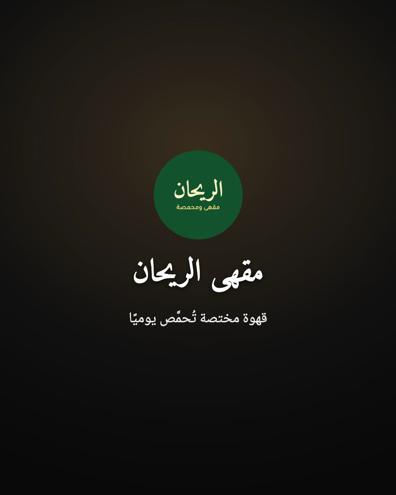
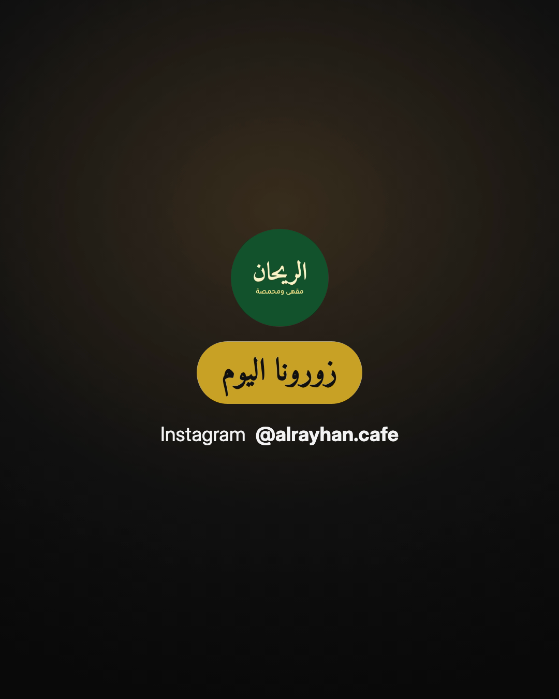

<div dir="rtl" lang="ar">

[الفهرس](00-الفهرس.md) · السابق: [البداية السريعة](03-البداية-السريعة.md) · التالي: [دليل صناعة الفيديو](05-دليل-صناعة-الفيديو.md)

# دليل الهوية 🎨

## ما هي «الهوية»؟

**ملف الهوية** هو المكان الذي يحفظ فيه الاستوديو اسمك وشعارك وألوانك وخطوطك.
**مثال:** مثل البطاقة التجارية لمحلك؛ تصممها مرة واحدة، ثم تظهر بنفس الشكل في كل مكان.
**ماذا تفعل؟** تجيب عن بضعة أسئلة مرة واحدة فقط، ثم تظهر هويتك تلقائيًا في كل فيديو.

الفيديو يحمل **هويتك أنت فقط**. لا يضيف الاستوديو أي شعار أو اسم لجهة أخرى إلى فيديوهاتك.

## الإعداد السريع (دقيقتان تقريبًا)

ابدأ بقولك للمساعد: «أريد إعداد هويتي».
سيسألك سؤالًا واحدًا في كل مرة، بهذا الترتيب:

### 1. الاسم

اكتب اسم نشاطك أو علامتك:

- بالعربية فقط، مثل: «مخبز السنبلة».
- أو بالإنجليزية فقط، مثل: `Sami Makes`.
- أو بالاثنين معًا، مثل: «دار السَّنا» مع الاسم الإنجليزي `Dar Al-Sana Studio`.

إذا كتبت الاسمين، يُحفظ كل واحد منهما في مكانه، ويظهر المناسب منهما حسب لغة الفيديو.

### 2. الشعار

أرسل ملف شعارك، أو ضعه في مجلد `inbox` وأخبر المساعد.

- **الأفضل:** صورة بصيغة PNG **بخلفية شفافة**، أي بلا مربع أبيض أو أسود حول الشعار.
- شعار بخلفية بيضاء يعمل أيضًا، لكن الشكل يكون أجمل بالخلفية الشفافة.
- المساعد ينظر إلى الشعار ويصفه لك في سطر، ليتأكد أنه الملف الصحيح.
- الشعار يُنسخ إلى ملف هويتك، والملف الأصلي لا يتغير.

**ليس عندك شعار؟** لا مشكلة أبدًا.
سيكتب الاستوديو اسمك بخط جميل في المقدمة والخاتمة بدلًا من الشعار.
وإذا صممت شعارًا لاحقًا، أرسله فقط وسيُضاف.

### 3. النمط

النمط يختار لك مجموعة ألوان وخطوط متناسقة دفعة واحدة. هناك ستة أنماط:

| النمط | الإحساس | الخط العربي للعناوين |
|---|---|---|
| **عصري** ⭐ | حديث ونظيف ومناسب لمعظم الأنشطة | Cairo |
| **فاخر** | راقٍ وهادئ، يناسب المقاهي والعطور والمجوهرات | Amiri |
| **مرح** | ملوّن وحيوي، يناسب الأطفال والحلويات والشباب | Cairo |
| **رسمي** | جاد وموثوق، يناسب الشركات والعيادات | Noto Kufi Arabic |
| **بسيط** | هادئ وقليل التفاصيل | Tajawal |
| **جريء** | قوي ولافت، يناسب العروض والتخفيضات | Cairo |

إذا لم تعرف، قل «اختر لي» وسيبدأ بالنمط العصري.

### 4. الألوان

عندك ثلاث طرق:

1. **أرسل كود اللون** إذا كنت تعرفه، مثل `#1E3A8A` للأزرق الداكن.
2. **أرسل صورة** من تصميمك أو شعارك، فيقرأ المساعد الألوان الأساسية منها ويقترحها عليك.
3. **قل «اختر لي»**، فيستخدم ألوان النمط الذي اخترته.

الهوية تحفظ لونًا أساسيًا، ولونًا ثانويًا، ولونًا مميزًا للأزرار والعبارات المهمة.

### 5. حساباتك على السوشيال ميديا

اكتب فقط الحسابات التي تستخدمها، مثل حسابك على Instagram أو TikTok أو رقم واتساب أو موقعك.
تظهر هذه الحسابات في **الخاتمة** آخر الفيديو.

### 6. جملة النهاية

هذه الجملة تقول للمشاهد ماذا يفعل بعد المشاهدة. أمثلة:

- «زورونا اليوم»
- «اطلبوا عبر واتساب»
- «تابعونا لمزيد من النصائح»

يمكن حفظ جملة بالعربية وأخرى بالإنجليزية.

### 7. المعاينة

في النهاية يجهّز المساعد صورتين لتراهما: **المقدمة** و**الخاتمة**، ثم يسألك: «هل يعجبك الشكل؟».





## الخطوط المجانية المرفقة

مع الاستوديو ستة خطوط مجانية، يجوز استخدامها في الفيديوهات التجارية:

| الخط | شخصيته | يناسب |
|---|---|---|
| Cairo | عصري وواضح وعريض | العناوين، الأنماط العصرية والمرحة والجريئة |
| Tajawal | نظيف وسهل القراءة حتى بالحجم الصغير | النصوص والترجمة أسفل الفيديو |
| Noto Kufi Arabic | كوفي منظم | الشركات والتقنية |
| Noto Naskh Arabic | نسخ كلاسيكي مريح للعين | النصوص الطويلة والأسلوب الفاخر |
| Amiri | نسخ أنيق تقليدي | المناسبات والأسلوب الفاخر والرسمي |
| Inter | خط لاتيني محايد | النصوص الإنجليزية |

### هل أستطيع استخدام خطي الخاص؟

نعم، **بشرط** أن يكون لديك **حق استخدام الخط** في الفيديو.
بعض الخطوط مجانية، وبعضها يحتاج شراء رخصة. سيسألك المساعد عن ذلك قبل إضافته.
بعد الإضافة يجرّب المساعد الخط على جملة عربية، فإذا ظهرت الحروف مقطّعة أو كمربعات فارغة،
يخبرك أن الخط لا يدعم العربية جيدًا ويُبقي أحد الخطوط المرفقة.

## إعدادات إضافية (اختيارية)

هذه الإعدادات تظهر عادةً في وضع المبدع أو المحترف، لكن يمكنك طلبها في أي وقت:

- **الشعار الصغير في زاوية الفيديو:** مطفأ في الأصل. إذا شغّلته يظهر شعارك صغيرًا في الزاوية العليا،
  ويختفي أثناء المقدمة والخاتمة.
- **شكل الأرقام:** أرقام عربية مثل ١٢٣، أو أرقام مثل 123. اختر ما يعتاد عليه جمهورك.
- **شكل الترجمة:** داخل مربع شفاف داكن، أو بحدود حول الحروف، أو بلون هويتك.
- **اللغة الأساسية:** عربية، أو إنجليزية، أو اللغتان معًا.
- **عبارة تعريفية قصيرة** تحت اسمك، مثل: «خبز طازج كل صباح».
- **تشغيل أو إيقاف** المقدمة والخاتمة.

## تغيير أي شيء لاحقًا

لا تحتاج أن تفتح أي ملف. اكتب للمساعد ما تريد، مثلًا:

- «غيّر اللون الأساسي إلى أخضر زيتي»
- «أضف حسابي على تيك توك: @example»
- «اجعل الأرقام عربية»
- «شغّل الشعار الصغير في الزاوية»
- «غيّر جملة النهاية إلى: احجز موعدك الآن»

التغيير يظهر في **الفيديوهات القادمة**. أما الفيديوهات التي جُهّزت قبل ذلك فتبقى كما هي.

## أكثر من هوية

يمكنك حفظ أكثر من هوية، مثلًا إذا كنت تصنع فيديوهات لعدة عملاء أو لعدة أنشطة.

- عند بدء كل فيديو، يسألك المساعد: «أي هوية نستخدم؟».
- كل مشروع يتذكر هويته.
- لا يخلط الاستوديو بين الهويات أبدًا. وإذا ظهر اسم هوية أخرى في الفيديو بالخطأ،
  يتوقف الفحص التلقائي ولا يسلّمك الفيديو حتى يُصلح.

## بدون هوية

لست شركة؟ تريد فيديو شخصيًا فقط؟
اختر «المتابعة بدون هوية». سيكون الفيديو بألوان هادئة محايدة، بلا شعار ولا اسم ولا مقدمة ولا خاتمة.

## أين تُحفظ هويتك؟

تُحفظ كل هوية في مجلد خاص داخل مجلد عملك:

```
URM-Creator-Studio/brands/<اسم الهوية>
```

داخله ملف الإعدادات، ونسخة من شعارك وخطوطك. هذا المجلد ملكك، ولا يُرفع إلى أي مكان.
احتفظ بنسخة احتياطية منه إذا أردت، كما تحتفظ بأي ملف مهم.

</div>
