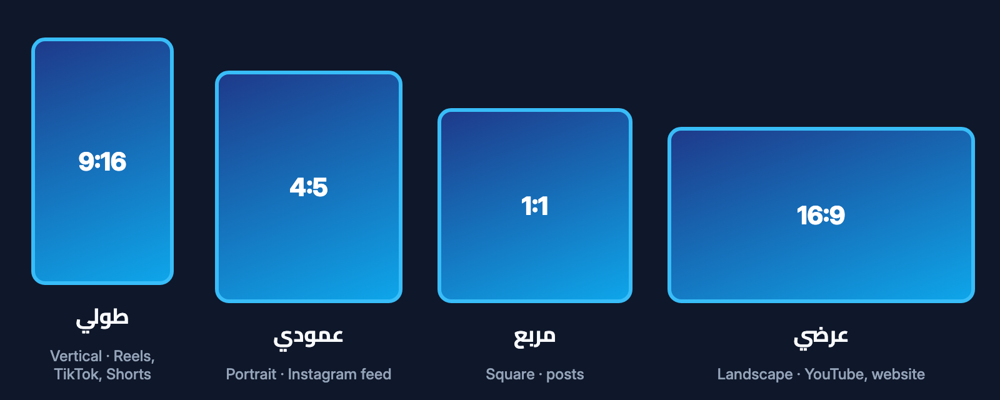
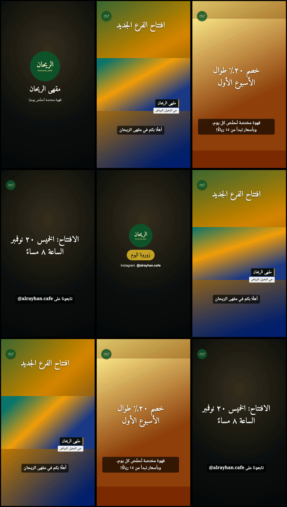

<div dir="rtl" lang="ar">

[الفهرس](00-الفهرس.md) · السابق: [دليل الهوية](04-دليل-الهوية.md) · التالي: [الخط العربي](06-الخط-العربي.md)

# دليل صناعة الفيديو 🎥

## أنواع الفيديو الثمانية

عندما تبدأ، يسألك المساعد عن نوع الفيديو. لكل نوع ترتيب مدروس للمشاهد يقترحه عليك:

| النوع | كيف يبدو عادةً | الشكل المقترح | المدة المقترحة |
|---|---|---|---|
| 1. فيديو قصير للسوشيال ميديا | جملة لافتة في أول ثانيتين، ثم 3 إلى 5 مشاهد سريعة، ثم جملة النهاية وهويتك | طولي | 15 إلى 30 ثانية |
| 2. إعلان تجاري | رغبة أو مشكلة، ثم منتجك كحل، ثم العرض أو السعر، ثم «اطلب الآن» | طولي، ونسخة مربعة | 15 إلى 30 ثانية |
| 3. فيديو تعريفي بالشركة | شعارك، من نحن، ماذا نقدم، لماذا نحن، ثم طرق التواصل | عرضي، ونسخة طولية | 45 إلى 90 ثانية |
| 4. فيديو لمنتج أو خدمة | لقطة جميلة للمنتج، ثم ثلاث مزايا، ثم المنتج أثناء الاستخدام، ثم السعر | طولي | 20 إلى 40 ثانية |
| 5. فيديو تعليمي | سؤال يشد الانتباه، ثم خطوات مرقّمة، ثم خلاصة، ثم «تابعنا للمزيد» | طولي للقصير، عرضي للطويل | 30 إلى 90 ثانية |
| 6. فيديو لفعالية أو مناسبة | لقطة واسعة للمكان، ثم الناس، ثم أهم اللحظات، ثم بطاقة شكر وتاريخ | طولي | 30 إلى 60 ثانية |
| 7. فيديو شخصي | صور بحركة هادئة، وعنوان جميل، وانتقالات ناعمة | طولي | 15 إلى 60 ثانية |
| 8. فكرة أخرى | يسألك المساعد سؤالًا إضافيًا ثم يختار أقرب ترتيب | حسب الفكرة | حسب الفكرة |

هذه اقتراحات فقط. يمكنك دائمًا أن تطلب مدة أو شكلًا آخر.

## أشكال الإطار

**شكل الإطار** يعني شكل الفيديو: طولي مثل شاشة الجوال، أو عرضي مثل شاشة التلفاز.
لا تحتاج أن تختار بنفسك؛ يكفي أن تخبر المساعد أين ستنشر، فيقترح الأنسب.



| الشكل | أين يُستخدم |
|---|---|
| **طولي** (٩:١٦) | ريلز، تيك توك، شورتس، سناب شات |
| **مربع** (١:١) | منشورات إنستغرام وفيسبوك |
| **عمودي** (٤:٥) | منشورات إنستغرام في الصفحة الرئيسية |
| **عرضي** (١٦:٩) | يوتيوب، موقعك، الشاشات والعروض |

يضع الاستوديو النصوص تلقائيًا في **المنطقة الآمنة**،
أي الجزء الذي لا تغطيه أزرار التطبيقات مثل زر الإعجاب واسم الحساب.

## نسخ بأشكال أخرى من نفس المشروع

صنعت فيديو طوليًا وتريده مربعًا أيضًا؟ لا تبدأ من جديد. اكتب فقط:

> جهّز نسخة مربعة من نفس الفيديو.

يعيد الاستوديو ترتيب النصوص لتناسب الشكل الجديد، ويحفظها في نسخة جديدة.

## نصائح للتصوير بالجوال 📱

صورة جيدة من الجوال أفضل من أي مؤثرات. جرّب هذه النصائح البسيطة:

1. **صوّر بالطول** إذا كان الفيديو للريلز أو تيك توك.
2. **قف قرب النافذة** أو في مكان فيه ضوء طبيعي.
3. **ثبّت الجوال بيديك الاثنتين**، أو أسنده على شيء ثابت.
4. **صوّر 5 ثوانٍ على الأقل لكل لقطة**، حتى يجد المساعد أفضل جزء.
5. **ابدأ التصوير قبل الحركة بثانية**، وأوقفه بعدها بثانية.
6. **إذا كنت تتكلم:** اختر مكانًا هادئًا، وقرّب الجوال من وجهك.
7. **نظّف العدسة** بقطعة قماش ناعمة قبل التصوير.

بعد أن تعطيه ملفاتك، يشاهد المساعد صورًا مصغّرة منها، ويخبرك بصراحة إذا كان مقطع ما مظلمًا أو مهتزًا،
ويقترح عليك ما تصوّره بدلًا منه.

### ملاحظة عن تصوير آيفون

بعض أجهزة آيفون تصوّر بألوان عالية النطاق (HDR). قد تبدو الألوان في الفيديو النهائي باهتة قليلًا.
إذا لاحظت ذلك، يمكنك إيقاف هذا الخيار في إعدادات الكاميرا للتصويرات القادمة. المساعد ينبّهك إذا وجده.

## الترجمة المكتوبة على الفيديو

إذا كان في الفيديو كلام، فالترجمة المكتوبة مهمة جدًا، لأن كثيرًا من الناس يشاهدون بلا صوت.

**الطريقة الأولى: الكتابة التلقائية (اختيارية)**
إذا كانت أداة تحويل الكلام إلى نص مثبّتة، يكتب الاستوديو **مسودة** لكلامك على جهازك، دون رفعها إلى الإنترنت.
ثم يعرضها عليك المساعد سطرًا سطرًا لتصحح الأسماء والأرقام.
الكلمات غير الواضحة تظهر بعلامة `[؟]` ولا يخمّنها المساعد أبدًا.

**الطريقة الثانية: أنت تكتب النص**
الصق النص الذي قلته في المحادثة، والمساعد يرتّب توقيته معك.

بعد موافقتك:

- تُكتب الترجمة **داخل الفيديو**، فتظهر دائمًا حتى لو لم يشغّلها المشاهد.
- ويُحفظ أيضًا **ملف ترجمة منفصل** يمكنك رفعه إلى يوتيوب أو فيسبوك.

## الموسيقى 🎵

استخدم **فقط** موسيقى تملكها أو مسموحًا لك باستخدامها، مثل:

- موسيقى اشتريتها مع رخصة استخدام.
- مكتبة الصوت المجانية في يوتيوب، حسب شروطها.
- موسيقى أعطاك صاحبها إذنًا.

الأغاني المشهورة من تطبيقات الاستماع **غير مسموحة** في فيديوهات الأعمال عادةً، حتى لو كنت مشتركًا.
المساعد لا ينزّل موسيقى من الإنترنت بدلًا منك.

إذا أضفت موسيقى، يضبط الاستوديو مستواها تلقائيًا، ويخفضها عند الكلام،
ويجعل الصوت النهائي بمستوى مناسب للمنصات. والخيار الافتراضي هو **بدون موسيقى**.

## التعليق الصوتي

الأفضل دائمًا **صوتك الحقيقي**: سجّل بجوالك في غرفة هادئة، وأرسل التسجيل.

على أجهزة ماك فقط، يمكن عمل تعليق بصوت كمبيوتر عربي مدمج في النظام.
لا يفعل المساعد ذلك إلا بعد موافقتك الصريحة، ويذكّرك أنه صوت آلي قد تطلب المنصات الإشارة إليه.
ولا يقلّد الاستوديو صوت أي شخص حقيقي.

## النسخ: v001 و v002 وما بعدهما

كل مرة يُجهَّز فيها الفيديو، تُحفظ **نسخة جديدة** في مجلد مستقل داخل المشروع:

```
URM-Creator-Studio/projects/<اسم المشروع>/output/v001
```

- النسخة الأولى في مجلد `v001`، ثم `v002`، وهكذا.
- النسخ التجريبية تأخذ رقمًا أيضًا، واسم ملفها ينتهي بكلمة `preview`.
- لا تُحذف النسخ القديمة إلا إذا طلبت أنت ذلك.
- إذا قلت «النسخة السابقة كانت أفضل»، يدلّك المساعد على مجلدها مباشرة.

داخل كل مجلد نسخة تجد الفيديو، وصورة مصغّرة له، وتقرير الفحص الذي يقرأه المساعد.

## ملفاتك الأصلية لا تتغير أبدًا

يعمل الاستوديو على **نسخ** من ملفاتك داخل المشروع فقط.
لا يعدّل الأصل، ولا ينقله، ولا يغيّر اسمه.
وإذا تغيّر ملف أصلي أثناء التجهيز لأي سبب، يتوقف الفحص التلقائي ويخبرك فورًا.

## الأشخاص في الفيديو

- يستخدم الاستوديو **التصوير الحقيقي** كما هو.
- لا يصنع وجوهًا أو أشخاصًا مزيّفين، ولا يغيّر وجه أحد أو صوته.
- إذا ظهر في الفيديو أطفال أو زبائن أو ضيوف يمكن التعرف عليهم، تأكد من موافقتهم قبل النشر.
  ويمكن للمساعد قص اللقطات التي لا تريدها.

## المساعد لا ينشر أبدًا

المساعد يعطيك ملف الفيديو فقط. **أنت** من ينشره، في الوقت والمكان الذي تختاره.
لا يدخل إلى حساباتك، ولا يرفع شيئًا، ولا يجدول منشورات.
وقبل النشر، شاهد الفيديو بنفسك مرة كاملة؛ فأنت أعرف الناس برسالتك وجمهورك.

## مثال لنتيجة



لأمثلة كاملة خطوة بخطوة، اقرأ صفحة [أمثلة](08-أمثلة.md).

</div>
