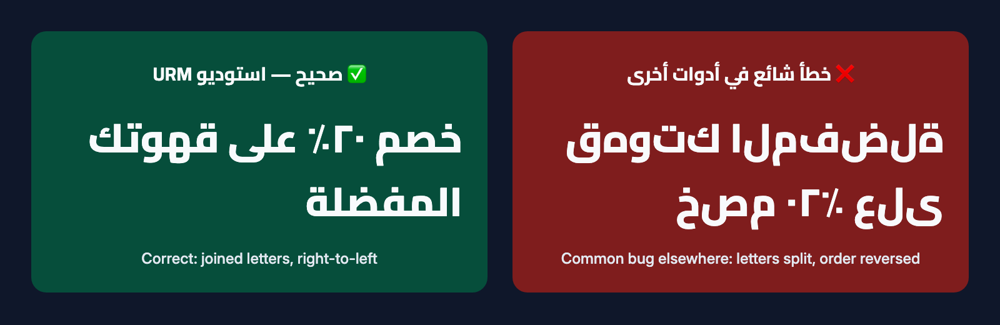

[الفهرس](00-الفهرس.md) · السابق: [دليل صناعة الفيديو](05-دليل-صناعة-الفيديو.md) · التالي: [حل المشكلات](07-حل-المشكلات.md)

# الخط العربي في الفيديو ✍️

## المشكلة التي يعرفها كل من جرّب

إذا جرّبت يومًا كتابة نص عربي على فيديو في بعض البرامج، فربما رأيت شيئًا من هذا:

- **حروف منفصلة:** تظهر كلمة «مرحبا» حروفًا متفرقة بدل أن تكون متصلة.
- **ترتيب معكوس:** تظهر الكلمة من اليسار إلى اليمين، فتُقرأ بالمقلوب.
- **علامات في غير مكانها:** علامة الاستفهام في بداية الجملة بدل نهايتها.
- **مربعات فارغة** بدل الحروف، لأن الخط لا يدعم العربية.

السبب ببساطة: كثير من برامج الفيديو صُممت أولًا للغات تُكتب من اليسار إلى اليمين بحروف منفصلة.
أما العربية فتحتاج أن يتغير شكل الحرف حسب مكانه في الكلمة، وأن يكون الاتجاه من اليمين إلى اليسار.

## كيف يضمن الاستوديو حروفًا صحيحة؟

### 1. المتصفح يرسم الحروف

لا يكتب الاستوديو العربية بمحرّك الفيديو مباشرة.
بل يرسم كل نص أولًا باستخدام **المتصفح الذي يرسم الحروف العربية** (Chrome أو Edge)،
وهو نفس المتصفح الذي يعرض لك المواقع العربية يوميًا بشكل صحيح. ثم يضع هذه الصورة فوق الفيديو.

النتيجة:

- حروف متصلة في أول الكلمة ووسطها وآخرها.
- «لا» و«لأ» و«لإ» و«لآ» تظهر بشكلها الصحيح.
- الحركات والشدة في مكانها.
- الاتجاه من اليمين إلى اليسار دائمًا.

### 2. المساعد يفحص الصور بعينه

بعد كل تجهيز، يستخرج الاستوديو صورًا من الفيديو في كل لحظة يظهر فيها نص.
ينظر المساعد إلى هذه الصور قبل أن يقول لك إن الفيديو جاهز، ويتأكد من:

- أن الحروف متصلة، ولا توجد مربعات فارغة أو علامات استفهام غريبة.
- أن الكلمات بالترتيب الصحيح، والأرقام والكلمات الإنجليزية في مكانها.
- أن لا شيء مقصوص عند أطراف الشاشة.
- أن النقاط والحركات ظاهرة وغير مقطوعة.
- أن النص بعيد عن أزرار التطبيقات ولا يغطي الوجوه.

إذا وجد مشكلة، يصلحها ويعيد التجهيز قبل أن يسلّمك الفيديو.

### 3. قواعد تلقائية أخرى

- لا يُضاف تباعد بين الحروف العربية، لأنه يقطع الاتصال بينها.
- مسافة مريحة بين السطور حتى لا تتلامس النقاط والحركات.
- إذا كان النص طويلًا، يصغر حجمه قليلًا ليبقى كاملًا داخل الإطار. لا يُقص أبدًا.
  وإذا بقي طويلًا جدًا، يقترح عليك المساعد اختصاره.
- الحركة كلمة بكلمة تظهر من اليمين إلى اليسار بترتيب صحيح.

## الأرقام

تختار في ملف الهوية شكل الأرقام في الفيديو:

| الخيار | الشكل | مثال |
|---|---|---|
| أرقام عربية | ٠١٢٣٤٥٦٧٨٩ | خصم ٢٠٪ |
| أرقام غربية | 0123456789 | خصم 20% |

نصيحة: استخدم **نوعًا واحدًا** في النص الواحد. إذا خلطت «٢٠» مع «8» في جملة واحدة، ينبّهك الفحص.
الأرقام داخل الأسماء الإنجليزية مثل `iPhone 15` تبقى كما هي.

## علامات الترقيم

استخدم العلامات العربية:

| العلامة | الشكل | مثال |
|---|---|---|
| الفاصلة | ، | قهوة، وحلويات، وأجواء جميلة |
| الفاصلة المنقوطة | ؛ | افتتحنا اليوم؛ تفضلوا بزيارتنا |
| علامة الاستفهام | ؟ | هل جربت قهوتنا؟ |
| النسبة المئوية | ٪ | خصم ٢٠٪ |

علامة نهاية الجملة تظهر في **أقصى اليسار**، لأن الجملة العربية تنتهي هناك. هذا صحيح، ولا يحتاج تصحيحًا.

## العربية والإنجليزية في جملة واحدة

يمكنك خلط اللغتين، مثل: «تابعونا على @alrayhan.cafe كل يوم».
الاستوديو يحافظ على الحساب أو الموقع أو رقم الهاتف كقطعة واحدة لا تنكسر.

نصيحة للكتابة: ضع الكلمة الإنجليزية **داخل** الجملة، لا في أولها ولا في آخرها.
مثلًا اكتب: «حمّل تطبيقنا Rayhan الآن» بدل أن تبدأ الجملة بالكلمة الإنجليزية.

## الترجمة أسفل الفيديو

للترجمة المكتوبة قواعد تجعل قراءتها مريحة، والاستوديو يفحصها تلقائيًا:

- **سطران كحد أقصى** في كل مرة.
- نحو **42 حرفًا** كحد أقصى في السطر الواحد.
- كل جملة تبقى على الشاشة **0.8 ثانية** على الأقل.
- سرعة لا تتجاوز نحو **17 حرفًا في الثانية**، حتى يلحق المشاهد بالقراءة.

إذا كانت جملة سريعة جدًا أو طويلة جدًا، ينبّهك المساعد ويقسمها.
وملف الترجمة المنفصل يحفظ اتجاه العربية بشكل صحيح عند رفعه إلى يوتيوب أو فيسبوك.

## التشكيل (الحركات)

- لا حاجة لتشكيل كل الكلمات. التشكيل الكامل يثقل النص على الشاشة.
- استخدمه فقط إذا كان المعنى قد يلتبس، مثل «تُحمَّص».
- للشعر يمكن تشكيل أكثر، بعد أن تتفق مع المساعد.

## الآيات القرآنية والنصوص الدينية

نتعامل معها بعناية خاصة:

- **أرسل النص بنفسك** أو وافق عليه حرفًا حرفًا؛ لا يكتبه المساعد من ذاكرته.
- يُكتب بخط نسخ واضح مثل Amiri أو Noto Naskh Arabic.
- لا يظهر بحركة «كلمة بكلمة».
- لا يوضع فوق موسيقى إلا إذا طلبت ذلك صراحة.

## كتابة النص الذي يظهر على الشاشة

المساعد يكتب لك النصوص بعربية بسيطة وقصيرة، ثم يعرضها عليك قبل التجهيز. أمثلة لأسلوبه:

- عناوين قصيرة: «افتتاح الفرع الجديد»، «خصم ٢٠٪ لأسبوع واحد».
- أفعال واضحة في النهاية: «اطلب الآن»، «زورونا اليوم»، «احجز موعدك».
- سبع كلمات كحد أقصى في العنوان الواحد.

إذا كنت تفضّل لهجتك المحلية، اكتب النص كما تريده بالضبط، وسيستخدم كلماتك كما هي.

