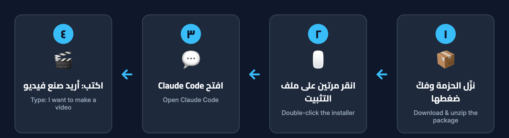

[← Back to the guide index](00-index.md)

# 02 · Installation

Installation has three parts:

1. Install **Claude Code** (the assistant).
2. **Unzip** the URM Creator Studio package.
3. **Double-click** the installer for your computer.

Allow about 10–20 minutes the first time, mostly for downloads.



---

## Step 1 — Install Claude Code

The easiest way is the **Claude desktop app**:

1. Go to **claude.ai/download** and download the app for your computer (Mac or Windows).
2. Install and open it, then sign in with your Claude account.
3. Click the **Code** tab. This is Claude Code — where you will chat with the studio.

> You need a Claude plan that includes Claude Code, or an Anthropic API account. See
> [Requirements](01-requirements.md).

**Prefer the terminal?** Claude Code can also be installed as a command-line tool. Follow the official
setup guide: https://docs.claude.com/en/docs/claude-code/setup — then start it by typing `claude` in a
terminal. Everything in these guides works the same way there.

---

## Step 2 — Unzip the package

1. Find the URM Creator Studio `.zip` file you downloaded.
2. **Mac:** double-click it. **Windows:** right-click → **Extract All…** → **Extract**.
3. Open the unzipped folder. You should see `Install-macOS.command`, `Install-Windows.bat`, a `skill`
   folder and an `examples` folder.

Important: keep all the files together. The installer needs the `skill` folder next to it. If you only
copy the installer somewhere else, it will say *"Studio files not found"*.

---

## Step 3 (Mac) — Run the installer

1. In the unzipped folder, **double-click `Install-macOS.command`**.
2. A Terminal window opens and the installer runs.

**If macOS blocks it** ("cannot be opened because it is from an unidentified developer"):

1. **Right-click** (or Control-click) `Install-macOS.command`.
2. Choose **Open**.
3. In the warning box, click **Open** again.

You only need to do this once.

**The installer speaks Arabic first.** For English messages, double-click
**`Install-macOS-English.command`** instead (same installer, English messages). Technical users can also
run `./install.sh --en` in Terminal.

Either way the result is the same — only the language of the installer's messages changes.

When it asks *"Install the FFmpeg video engine now with Homebrew? [y/N]"*, type `y` and press Enter
if you want it installed now. (This question only appears if FFmpeg is missing and Homebrew is already
on your Mac.) When the installer finishes, press Enter to close the window.

---

## Step 3 (Windows) — Run the installer

1. In the unzipped folder, **double-click `Install-Windows.bat`**.
2. A window opens and the installer runs.

If Windows shows a blue **"Windows protected your PC"** screen, click **More info** → **Run anyway**.

Like the Mac version, the Windows installer shows **Arabic messages by default**. For English
messages, double-click **`Install-Windows-English.bat`** instead.

The installer may ask you two questions, and **always waits for your answer**:

- *"Install it now with winget?"* — only if Python is missing.
- *"Install the FFmpeg video engine now with winget? (free)"* — only if FFmpeg is missing.

Type `y` and press Enter to accept. After FFmpeg is installed, **close the installer window and reopen
Claude Code** so it can find FFmpeg.

---

## What the installer does

The installer is careful and only does the following:

1. **Checks** that the studio files are next to it and that Python 3.8 or newer is available.
2. **Copies the skill** into Claude Code's skills folder:
   - Mac/Linux: `~/.claude/skills/urm-creator-studio`
   - Windows: `%USERPROFILE%\.claude\skills\urm-creator-studio`
   If an older copy is already there, it is **moved aside as a backup** (named
   `urm-creator-studio.backup-<date-time>`), not deleted.
3. **Creates your workspace**, the folder `URM-Creator-Studio` in your home folder, with
   `brands`, `projects` and `inbox` inside.
4. **Saves your language** (Arabic, or English if you used an English installer).
5. **Runs a device check** and shows a list with ✅, ❌ or ➖ for each item.
6. **Asks before installing FFmpeg** (and, on Windows, Python) if they are missing.

It **never** touches your existing brands, projects or videos. Re-running it later is safe.

---

## How to confirm it worked

At the end of the device check you should see:

```
✅ Your computer is ready to make videos.
```

followed by *"🎉 Installation finished."*

What the symbols mean:

| Symbol | Meaning |
|---|---|
| ✅ | Ready |
| ❌ | Required item missing — follow the fix shown under it, or ask the assistant for help |
| ➖ | Optional item not installed (speech-to-text, built-in voice) — fine to skip |

If you see *"Something required is missing"*, don't worry. You can still open Claude Code: the
assistant runs the same check at the start of every session and guides you through any fix, one step
at a time, asking before it installs anything. See also [Troubleshooting](07-troubleshooting.md).

---

## Final check: say hello

1. Open Claude Code (desktop app → **Code** tab, or `claude` in a terminal).
2. Type: `Hi, I want to make a video` — or type `/urm-creator-studio`.
3. The studio greets you and shows the language switch `🌐 العربية | English`.

If it greets you, you're done. Continue with [Getting started](03-getting-started.md).

If Claude Code doesn't seem to know the studio, fully quit and reopen Claude Code (skills are loaded
when it starts), then try again.

---

## Re-installing or updating

To install a newer version, unzip the new package and run its installer again. Your previous skill copy
is kept as a backup, and your workspace (brands, projects, videos) is untouched. To uninstall, see the
[FAQ](09-faq.md).

---

[← Requirements](01-requirements.md) · Next: [Getting started →](03-getting-started.md)
