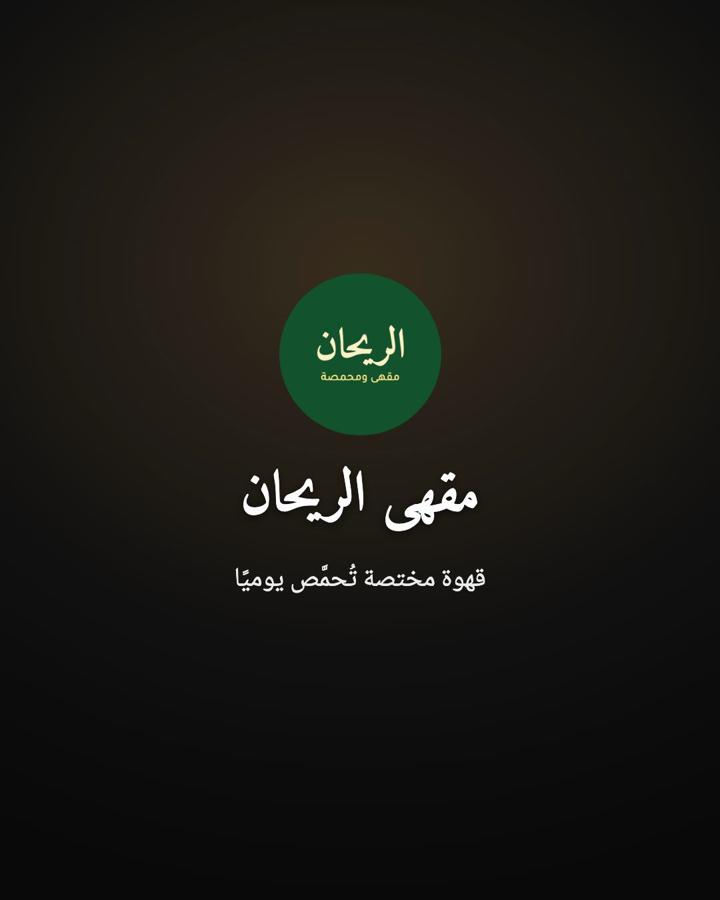
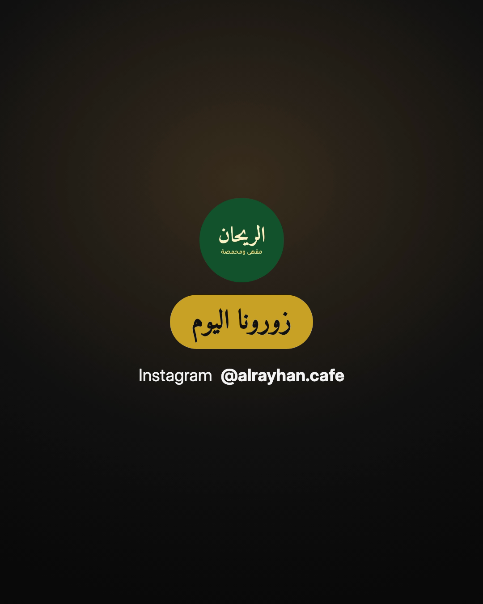

[← Back to the guide index](00-index.md)

# 04 · Brand guide

Your **brand profile** is your saved look: name, logo, colours, fonts, social handles and a closing
call-to-action. Set it up once and every video uses it automatically — an intro with your logo or name,
an outro with your call-to-action and handles, and your colours on titles and name banners.

Your videos always carry **your** brand only. The studio never adds URM ENROLL's name or logo, and it
never mixes one brand into another brand's video. The automatic quality check fails a video if it finds
another brand's name, handle or files in it.

---

## Quick setup (about two minutes)

When you start your first video, the assistant offers *"Quick brand setup ⭐ recommended"*. It asks
one thing at a time:

1. **Your name.** Write it in Arabic, English or both. Arabic and English names are saved separately,
   so a bilingual brand can show the right one in each language.
2. **Your logo.** Send the file (a PNG with a transparent background looks best; JPG, WEBP and SVG also
   work). The assistant looks at it and describes it in one line so you can confirm it's the right file.
   If your logo has a solid white or black box around it, it will suggest a transparent version but can
   still use it. **No logo? No problem** — see below.
3. **Style.** Pick one of six styles. Each sets matching colours and fonts:

   | Style | Feel | Default Arabic fonts |
   |---|---|---|
   | **Modern** ⭐ | Clean, current | Cairo + Tajawal |
   | **Luxury** | Elegant, premium | Amiri + Noto Naskh Arabic |
   | **Playful** | Fun, youthful | Cairo |
   | **Corporate** | Trustworthy, structured | Noto Kufi Arabic + Tajawal |
   | **Minimal** | Calm, simple | Tajawal |
   | **Bold** | Loud, sales-ready | Cairo |

4. **Colours.** Send your colour codes (like `#1E3A8A`), send an image of your design and the assistant
   proposes colours from it, or say "choose for me". A brand has a primary, secondary and accent colour,
   plus a text colour and a colour for text on the accent.
5. **Social handles.** Only the ones you use: Instagram, TikTok, YouTube, Snapchat, X, Facebook,
   LinkedIn, website, WhatsApp. They appear in the outro.
6. **Call-to-action.** One closing sentence per language, such as "Follow for more tips" or
   «زورونا اليوم».
7. **Preview.** The assistant checks the profile and shows you two preview pictures — your intro and
   your outro — and asks if you like the look.





---

## No logo

Many small businesses don't have a logo yet. That's fine: the intro shows your **name as a stylish
text wordmark** in your brand fonts (both names for bilingual brands), and the outro shows your name.
If you get a logo later, send it and the assistant adds it.

## No brand at all

You can also continue without a brand. The video then uses a neutral dark style with no intro, no
outro, no small corner logo and no names — unless you ask for a closing line.

---

## Extra options (Creator and Pro modes)

| Option | What it does |
|---|---|
| **Fonts per role** | Different fonts for Arabic headings, Arabic body text, Latin headings and Latin body text. |
| **Personality words** | e.g. "warm, authentic" — guides pace, transitions and text animation. |
| **Tagline** | A short line in Arabic and/or English. |
| **Intro / outro** | Turn on or off and change their length. |
| **Watermark** | A small logo in the top corner during the video (top-left for Arabic videos, top-right for English). You can set on/off and transparency. It is hidden during the intro and outro. Off by default. |
| **Caption style** | `box` (text on a semi-transparent dark box — most readable), `outline`, or `brand` (your brand colour). |
| **Numerals** | Western digits `0123` or Arabic-Indic digits `٠١٢٣` in your videos. |
| **Primary language** | Arabic, English or bilingual. |

---

## Bundled fonts

The studio comes with six high-quality fonts under the **SIL Open Font License (OFL)**, which allows
free use in commercial videos.

| Font | Character | Good for |
|---|---|---|
| **Cairo** | Modern, geometric, many weights, includes Latin letters | Modern, playful, bold brands |
| **Tajawal** | Clean, friendly, very readable when small | Body text, captions |
| **Noto Kufi Arabic** | Structured Kufi style | Corporate, tech |
| **Noto Naskh Arabic** | Classic book-style Naskh, highly readable | Luxury body text, long captions |
| **Amiri** | Elegant classical Naskh | Luxury, cultural, formal |
| **Inter** | Neutral Latin (English) font | English text |

### Using your own font

You can add a custom font (TTF, OTF, WOFF or WOFF2) **only if you have the licence to use it in videos**.
The assistant will ask you to confirm this before adding it. Many fonts are free for personal use but
need a paid licence for business videos — check where you got the font.

After adding a font, the assistant renders a small test card with Arabic letters, ligatures and digits
and looks at it. If letters show as boxes ☐ or come apart, the font doesn't properly support Arabic,
and the assistant keeps a bundled font for Arabic text.

---

## Changing your brand later

Just ask in plain words:

- "Change my accent colour to #F97316"
- "Add my TikTok handle @mybrand"
- "Turn on the small logo in the corner"
- "Use Amiri for Arabic headings"
- "Change my closing line to 'Order on WhatsApp'"

Changes apply to **future** videos. Videos you already made stay exactly as they were.

---

## Several brands

If you make videos for more than one business — your own and a client's, for example — you can keep as
many brand profiles as you like. The assistant **always confirms which brand a project uses**, and the
project remembers it. A video only ever reads its own brand's files.

To switch an existing project to another brand, just ask; the assistant updates the project and makes
a new version.

---

## Where your brand is stored

Brand profiles live in your workspace, not inside the studio software:

```
URM-Creator-Studio/brands/<brand-name>/
  brand.json     ← your settings
  assets/        ← copies of your logo and custom fonts
  preview/       ← the intro/outro preview pictures
```

Because of this, re-installing or updating the studio never touches your brands. Your original logo
and font files are **copied** in — the originals stay where they were.

---

## Example brands

The package includes fictional example brands in `examples/brands/` — for instance **Sami Makes**
(English creator), **Dar Al-Sana Studio** (bilingual design studio), **Al Rayhan Cafe** (Arabic café)
and **Al-Sunbula Bakery** (Arabic bakery with no logo). The assistant can load one to show you what a
finished profile looks like. They are for demonstration only — it will tell you before using one, and
never uses them for your real videos.

---

[← Getting started](03-getting-started.md) · Next: [Video guide →](05-video-guide.md)
