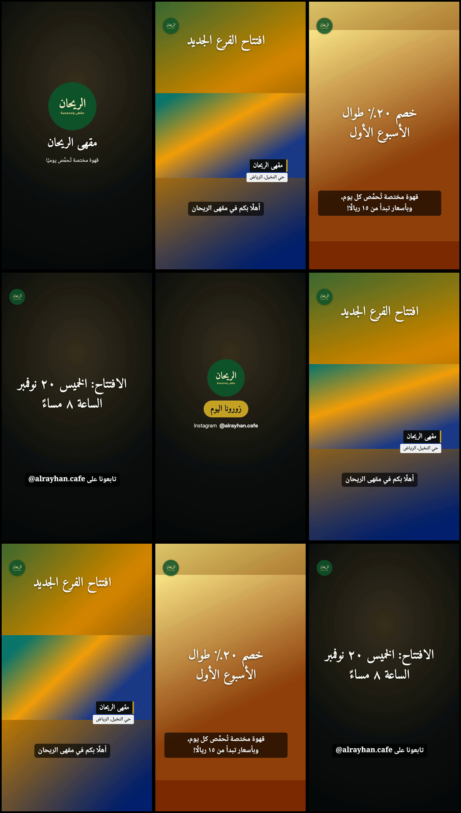
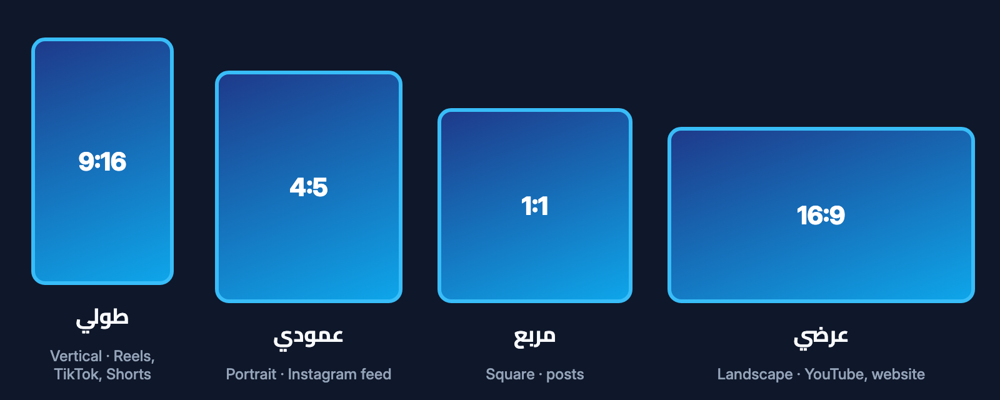

[← Back to the guide index](00-index.md)

# 05 · Video guide

This guide explains the kinds of videos you can make, the shapes available, how to film good material
on your phone, and how captions, music, versions and extra formats work.

---

## The 8 video types

When you start, the assistant asks what you want to make. Each choice comes with a proven structure,
a default shape and a typical length.

| # | Type | Typical structure | Default shape | Typical length |
|---|---|---|---|---|
| 1 | **Short social video** (Reels, TikTok, Shorts) | Strong hook in the first 2 seconds → 3–5 quick scenes → call-to-action + brand | Tall | 15–30 s |
| 2 | **Advertisement** | Problem or wish → your product as the answer → proof or offer → call-to-action | Tall (+ square copy) | 15–30 s |
| 3 | **Company introduction** | Logo → who we are → what we do → why us → people/place → contact | Wide (+ tall cut) | 45–90 s |
| 4 | **Product or service** | Hero shot → three features with benefits → in use → price/offer → call-to-action | Tall | 20–40 s |
| 5 | **Educational / how-to** | Question hook → numbered steps → recap → "follow for more" | Tall (short) / wide (long) | 30–90 s |
| 6 | **Event or occasion** | Atmosphere → arrivals → key moments → reactions → date/thanks card | Tall | 30–60 s |
| 7 | **Personal** | Photos with gentle motion, a title card, soft fades | Tall | 15–60 s |
| 8 | **Something else** | The assistant asks one follow-up question and picks the closest structure | — | — |

The assistant also knows how to handle **talking-head videos** (trimming pauses and false starts with
your approval, adding a name banner and captions), **longer YouTube videos** with chapter cards, and
**campaigns** — a series of videos sharing the same intro, outro and caption style.

---

## Shapes

| Shape | Size | Best for |
|---|---|---|
| **Tall (vertical) 9:16** | 1080 × 1920 | Instagram Reels, TikTok, YouTube Shorts, Snapchat |
| **Square 1:1** | 1080 × 1080 | Instagram and Facebook feed posts |
| **Portrait 4:5** | 1080 × 1350 | Instagram feed |
| **Wide (landscape) 16:9** | 1920 × 1080 | YouTube, websites, presentation screens |

You don't need to remember these. Tell the assistant where you'll post and it picks the right one.

All on-screen text is kept inside the **safe area** — the part of the screen not covered by app
buttons (for example TikTok's buttons on the right and username at the bottom).

---

## Filming tips for phones

Good footage matters more than any effect. Simple tips:

- **Film the shape you'll post.** Hold the phone upright for Reels/TikTok, sideways for YouTube.
- **Use window light.** Face the light; avoid strong light behind the person.
- **Hold steady** with both hands, or lean on something. Count to 5 before and after the action —
  the studio trims the shaky start and end.
- **Short shots:** about 5 seconds each, several angles of the same thing.
- **Sound:** for talking, use a quiet room and stay close to the phone (about 20 cm for voice recordings).
- **iPhone HDR:** HDR video can look washed out after editing. If colours look off, turn off HDR video
  for future recordings (Settings › Camera › Formats › HDR Video). The quality check warns you about
  HDR clips.

No footage? The assistant can make a text-and-photo video using your brand colours. It never creates
artificial people.

---

## Captions (subtitles)

Captions make your video work with the sound off.

**If you have speech-to-text installed** (optional, see [Requirements](01-requirements.md)):

1. The assistant first puts the video together without captions, so the cut is final.
2. It turns the speech into **draft** subtitles — on your computer, nothing uploaded.
3. **You review them.** Unclear parts are marked `[?]` and the assistant asks you to correct names,
   numbers and every flagged line. It never guesses words.
4. Approved captions are checked for readability (not too long or too fast) and written into the video.

**Without speech-to-text:** type or paste what is said, and the assistant times the subtitles with you.

Each captioned version also includes **subtitle files** (`captions.srt` and `captions.vtt`) that you can
upload to YouTube or Facebook as a separate subtitle track.

**Translated subtitles:** the assistant can translate captions (for example English speech → Arabic
subtitles). The translation is marked as a translation and you approve it before it's used. One
language can be written into the video and another provided as a separate file — or you get two
versions of the video.

---

## Music

- Use only music **you own or have a licence for**: music you bought with business rights, a
  composer's permission, or a free library such as the YouTube Audio Library (under its terms).
- Songs from streaming apps are **not** licensed for business videos.
- The assistant **never downloads music** for you.
- Music is automatically kept quieter under speech ("ducking"), fades in and out, and the final mix is
  set to the standard volume for social media.
- For energetic videos, a soft "whoosh" can be added on transitions — it is generated by the studio, so
  there are no licence issues.

---

## Versions

Every time the video is put together, it's saved in a **new numbered folder**: `v001`, `v002`, `v003`…
Nothing is overwritten. If you prefer an earlier version, just say so and the assistant points you to it.

Old versions are only deleted if you ask.

---

## Your originals are never modified

The studio copies your files into the project and works only on the copies. The quality check even
confirms that no original file changed during the render — if one did, it stops and tells you.

---

## Re-export to other shapes

Made a tall Reel and want a square version too? Ask:

> "Can I also have a square version for my Instagram feed?"

The assistant re-renders the same project in the new shape. Texts are laid out again automatically for
the new shape, and the result goes into a new version folder.

---

## Quality check — every time

After each render the studio runs automatic checks (size, length, sound level, text not cut off, text
inside the safe area, no overlapping text, consistent digits, brand isolation, caption readability).
The assistant also **looks at pictures taken from your video** before telling you it's ready, and tells
you plainly about any warnings. A video that fails the check is fixed, not delivered.

Please still **watch the video once yourself** before posting — only you can judge your message.

---

## The assistant never publishes

The studio never uploads, posts, schedules or sends your videos, and never logs into your social media
accounts. When the video is ready, it tells you where the file is. **You** decide when and where to
post it.

---

[← Brand guide](04-brand-guide.md) · Next: [Arabic typography →](06-arabic-typography.md)
