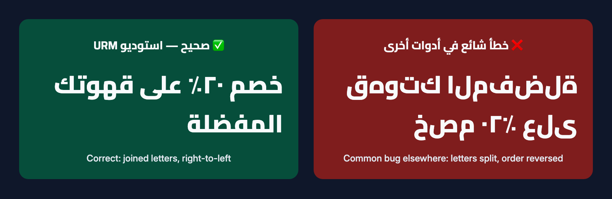

[← Back to the guide index](00-index.md)

# 06 · Arabic typography

This guide is for English speakers who make Arabic content, or who run a bilingual (Arabic/English)
brand. You don't need to read Arabic to benefit from it — the studio handles the hard parts — but it
helps to know what "correct" looks like and what to check.

---

## Why Arabic often breaks in video tools

Arabic is harder to display than English for two reasons:

1. **Letters connect and change shape.** Most Arabic letters have up to four forms depending on whether
   they stand alone or sit at the start, middle or end of a word. Some pairs combine into a single
   shape (a *ligature*), such as lam + alef → «لا».
2. **Arabic reads right-to-left**, while numbers, English words, @handles and web addresses inside an
   Arabic sentence read left-to-right. Getting the order right needs special rules (called *bidi*).

Many video editors and simple text tools skip these steps. The result is a common failure:
**letters appear separated, and words come out reversed** — unreadable to Arabic speakers and
embarrassing for a brand.

---

## How the studio guarantees correct Arabic

**1. Every piece of text is drawn by a real browser.**
The studio uses Google Chrome or Microsoft Edge in the background to lay out all on-screen text —
the same text engine that shows Arabic websites correctly. This gives connected letter forms,
ligatures (including «لا» and the word «الله»), correct placement of vowel marks, right-to-left order,
and correct ordering of mixed Arabic/English text. The text is then placed onto your video.

It never uses the shortcut of drawing Arabic with the video engine's basic text tool, never reverses
words by hand, and never adds letter spacing (which breaks the joins).

**2. Frames are inspected before you hear "it's ready".**
After every render the studio saves a picture of every moment where text appears. The assistant
**looks at these pictures** and checks that:

- letters are joined — no isolated letters inside words, no empty boxes ☐ or question marks,
- words read right-to-left in the intended order, with numbers and English words in the right place,
- nothing is cut off at the edges, and dots and vowel marks are fully visible,
- text is clear of app buttons and doesn't cover faces or other text.

If anything is wrong, it fixes the plan and renders again. Only then does it tell you the Arabic has
been checked.

**3. Fonts are tested.** The bundled fonts (Cairo, Tajawal, Noto Kufi Arabic, Noto Naskh Arabic, Amiri)
fully support Arabic. A custom font is tested with a sample card before use — see
[Brand guide](04-brand-guide.md).

---

## Rules applied automatically

- **Direction** is taken from the first real letter of each text: Arabic-first text is right-to-left,
  English-first text is left-to-right.
- **@handles, #hashtags, web addresses, e-mails, phone numbers and your English brand name** are kept
  together left-to-right and never split across lines. So «تابعونا على @brand_x» stays intact.
- **Line spacing** is more generous for Arabic so dots and marks have room.
- **Long text** is balanced across lines and shrinks to fit the safe area — it is never cut off. If it
  still doesn't fit, the assistant shortens it with you.
- **Mixed text** uses the Arabic font for Arabic letters and the Latin font for English letters.
- **Name banners** align to the right in Arabic videos and to the left in English videos.
- **Slide transitions** move in the reading direction; word-by-word reveals appear right-to-left.

---

## Numerals

Arabic content can use two digit systems:

| Style | Looks like | Common in |
|---|---|---|
| **Western** | 0 1 2 3 4 5 6 7 8 9 | Widely read online across Arab countries; default |
| **Arabic-Indic** | ٠ ١ ٢ ٣ ٤ ٥ ٦ ٧ ٨ ٩ | Traditional style, still common in many Arab countries |

Your brand profile picks one. With Arabic-Indic digits, numbers in Arabic text are converted
automatically, but digits inside English words (like "iPhone 15") are left alone.

Use **one system per text**. The quality check warns you if a text mixes ٢٠ and 20.
Percentages follow the same style: «٢٠٪» with Arabic-Indic digits, «20%» with Western digits.

---

## Punctuation

Arabic has its own punctuation marks:

| Mark | Arabic | English |
|---|---|---|
| Comma | ، | , |
| Semicolon | ؛ | ; |
| Question mark | ؟ | ? |
| Exclamation mark | ! | ! (shared) |

In right-to-left text, the full stop or question mark at the end of a sentence appears on the
**left** end of the line. That is correct — don't ask for it to be "moved back".

---

## Mixed Arabic and English

- Keep English words **inside** an Arabic sentence rather than at the very start or end, so the
  direction is unambiguous. For example: «انشر الفيديو على Instagram مباشرةً».
- If a line must start with an English word but is Arabic overall, start it with an Arabic word instead,
  or split it into two lines.
- English brand names stay in English letters unless your brand has an official Arabic name.
- For bilingual brand posts, the usual pattern is the Arabic line first, the English line under it.

---

## Captions in Arabic

- At most about **42 characters per line**, **two lines** per caption.
- Each caption stays on screen for at least 0.8 seconds and isn't faster than about 17 characters per second.
- The **box** style (text on a semi-transparent dark box) is the most readable over busy footage;
  **outline** suits clean shots.
- The subtitle files (`captions.srt` / `.vtt`) include invisible right-to-left marks around Arabic lines,
  so YouTube and Facebook show punctuation on the correct side.

---

## What you should still check

The studio guarantees that Arabic is *drawn* correctly. The *words* are your responsibility:

- Ask an Arabic speaker to read the on-screen text if you don't read Arabic yourself.
- Spelling details matter (for example أ / إ / ا, ة / ه, ى / ي).
- Vowel marks (tashkeel) are used only where meaning would be unclear.
- For Quranic verses, hadith or religious phrases, provide or approve the exact text yourself. The studio
  renders them in a classical font (Amiri or Noto Naskh), never animates them word by word, and asks
  before placing them over music.
- The assistant writes Modern Standard Arabic by default; if you want a dialect, give it your wording.

---

[← Video guide](05-video-guide.md) · Next: [Troubleshooting →](07-troubleshooting.md)
